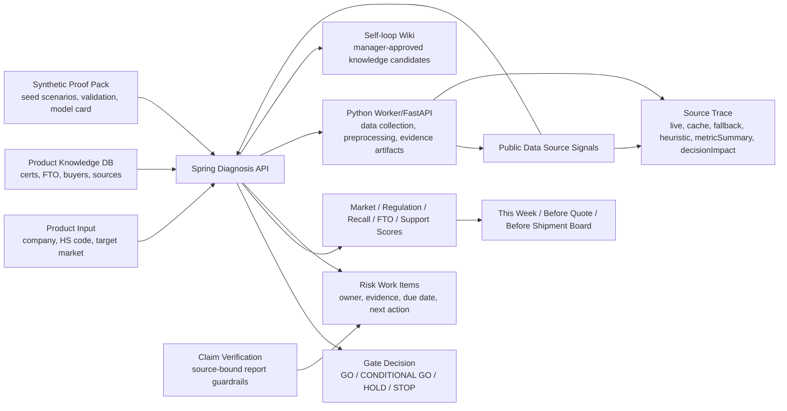

# GROW-GATE Local EX

> 지역 제조기업을 위한 바이어 문의 기반 수출 Gate 판단 서비스.
> 제출용 메인 앱은 React FE-02 + Spring Boot BE-02이며, 제품·HS Code·대상국·바이어 요구사항·제품 지식과 공공데이터 출처 신호를 GO/CONDITIONAL GO/HOLD/STOP 판단과 업무 보드로 연결합니다.


---

## Table of Contents

1. [Main App (FE-02 / BE-02)](#1-main-app-fe-02--be-02)
2. [Why](#2-why)
3. [What It Does](#3-what-it-does)
4. [Public Data Coverage](#4-public-data-coverage)
5. [Screens](#5-screens)
6. [Quick Start](#6-quick-start)
7. [Code Gate Git Bridge](#7-code-gate-git-bridge)
8. [Architecture](#8-architecture)
9. [Repository Layout](#9-repository-layout)
10. [Verification](#10-verification)
11. [Current Demo Scenario](#11-current-demo-scenario)
12. [Deployment Status](#12-deployment-status)
13. [Security Notes](#13-security-notes)
14. [License](#14-license)
15. [Timeline](#15-timeline)

---

## 1. Main App (FE-02 / BE-02)

| Type | Path | Stack | Description |
| :--- | :--- | :--- | :--- |
| React FE | `frontend/FE-02/` | React 18 + Vite | [frontend/FE-02/README.md](frontend/FE-02/README.md) |
| Spring Boot BE | `backend/BE-02/` | Spring Boot 3.4 + MySQL | [backend/BE-02/README.md](backend/BE-02/README.md) |

최근 제출 보완 내역은 [docs/submission-update-report.md](docs/submission-update-report.md)에 정리했습니다. 첨부 평가 항목별 완료/미완료 판정은 [docs/evaluation-resolution-status.md](docs/evaluation-resolution-status.md)에서 확인할 수 있습니다. 팀 공유용 업데이트 요약은 [docs/team-update-2026-06-30-submission-hardening.md](docs/team-update-2026-06-30-submission-hardening.md)에 별도로 정리했습니다.

심사용 합성 데이터팩 적용 정책은 [docs/SYNTHETIC_DATA_POLICY.md](docs/SYNTHETIC_DATA_POLICY.md), 3개 seed 시나리오 계정과 진단 ID는 [docs/demo-scenarios.md](docs/demo-scenarios.md), 제출 범위와 zip 제외 기준은 [SUBMISSION_SCOPE.md](SUBMISSION_SCOPE.md)에 고정했습니다. 합성 데이터는 반드시 `synthetic_demo_not_real_customer`로 설명하며, live 공공 API proof로 계산하지 않습니다.

실제 공공 API 증거는 `/api/admin/public-data/proof-runs`가 생성하는 `proofRunId`, `rawResponseSha256`, `schemaValidationStatus`, `operationEndpoint`, `apiKeyConfigured` 기준으로만 인정합니다. Synthetic persona validation은 [docs/validation/README_SYNTHETIC_VALIDATION.md](docs/validation/README_SYNTHETIC_VALIDATION.md)에 분리했고, 실제 고객 검증 자료처럼 표현하지 않습니다. 보고서 공식 산출물은 Markdown이며 PDF는 [docs/report/REPORT_FORMAT_POLICY.md](docs/report/REPORT_FORMAT_POLICY.md)의 선택 인쇄/변환 전략만 사용합니다. Pilot ML artifact는 `python3 ml/pipelines/train_all.py`로 생성하며 `/api/ml/models/latest`에서 버전과 한계를 조회합니다.

2026-07-06 기준 GitHub `main`에는 심사용 방어 패키지와 공개 proof 뷰어, source-bound S04-S09 화면 방어가 포함되어 있습니다.

- 3개 합성 seed 기업, 지역산업 profile, agent trace event schema, synthetic persona validation
- public-data proof run API와 S10 proof surface
- `/public-data/daily-refresh` 공개 read-only proof 화면
- 매일 08:00 KST, 최근 활성 제품 최대 30개 대상 daily public-data refresh
- raw response hash, schema validation status, live/cache/fallback waterfall
- Markdown report archive, HTML preview, browser print-to-PDF flow
- synthetic rule-assisted ML artifact와 `/api/ml/models/latest` 제한 고지
- HttpOnly cookie 기반 로그인 세션 복원
- `scripts/check-risk-gates.sh` 기반 제출 리스크 회귀 차단
- S04-S09 stage card가 `0 live/cache`, `Spring 로컬`, `KIPRIS/public trace 0건` 같은 구현/빈근거 문구를 그대로 노출하지 않고, 공공데이터·보조출처·fallback·담당자 검토 필요 상태를 분리 표시

심사 대응 기준 문서는 [docs/top15-resolution-2026-07-01.md](docs/top15-resolution-2026-07-01.md)입니다. 15개 치명 항목의 처리 상태, code reference, 남은 상용화 과제를 이 문서에 고정했습니다.
90점권 시연 증거 기준은 [docs/judge-defense-90.md](docs/judge-defense-90.md), 공공데이터 metric/score 매핑은 [docs/public-data-field-mapping.md](docs/public-data-field-mapping.md), 발표 서버 환경 변수 템플릿은 [.env.example.presentation](.env.example.presentation)에 정리했습니다.

| 홈 | 수출 Gate 판단 결과 |
| :--- | :--- |
|  |  |

---

## 2. Why

지역 제조기업은 제품을 해외에 팔기 전에 시장성보다 더 현실적인 질문에 막힙니다.

- 이 제품에 어떤 인증과 시험이 필요한가
- 유사 리콜 위험은 무엇인가
- 특허/FTO 리스크는 어디부터 봐야 하는가
- 지원사업으로 어떤 비용을 줄일 수 있는가
- 견적 전, 출하 전 어떤 근거와 문서를 확보해야 하는가

GROW-GATE Local EX는 이 질문을 바이어 회신 가능한 Gate 판단과 담당자 업무 보드로 바꿉니다.

---

## 3. What It Does

| 영역 | 기능 |
| :--- | :--- |
| Gate 판단 실행 | 기업·제품·HS Code·대상국·바이어 문의를 입력하면 Spring API가 실제 판단 run을 생성하고 결과 id로 이동 |
| 규칙 기반 스코어링 | HS Code, 대상국, 인증 만료, FTO 위험, 바이어 요구사항, 지식 신뢰도, 출처 수를 점수에 반영 |
| 공공데이터 근거 추적 | 관세청, KOTRA, Safety Korea, KIPRIS, 지원사업의 live/cache/fallback 수집 상태와 metric 기반 contribution을 `sourceId`, `matchedKey`, `usedFor`, `confidenceAdjustedContribution`으로 반환 |
| 안전 공개 웹 크롤링 | API가 없거나 보조 근거가 필요한 경우, 명시된 HTTPS allowlist URL만 수집해 마스킹/전처리 후 `sourceType=crawl`로 적재 |
| source-bound evidence retrieval | 제품 지식, 담당자 문서, 공공데이터 record, 승인된 loop 항목을 출처가 묶인 top-k evidence chunk로 검색 |
| export knowledge timeline | sourceId, sourceType, fetchedAt, publishedAt/sourcePeriod, scoreImpact를 분리해 “언제 수집한 어떤 근거가 점수에 영향 줬는지” 표시 |
| self-loop wiki 근거화 | 제품 지식, 인증, FTO, 바이어 요구, 공공데이터 record를 chunk화하고 담당자 승인 지식화 후보를 다음 판단 context에 재사용 |
| Workflow trace | Spring `AgentLoop`가 plan, tool call, observation, verifier, retry, fallback, complete task를 기록 |
| Decision Brief | 결과 첫 화면에서 Gate 판단, 핵심 위험 3개, `오늘 할 일`/`이번 주 할 일`/`외부기관 문의` 3개 행동을 먼저 표시 |
| Gate 업무 보드 | 이번 주, 견적 전, 출하 전 단위로 담당자, 산출물, 시험·인증 태스크를 정리 |
| 리포트 보관함 | 완료된 진단의 공식 Markdown 리포트를 마이페이지에서 다운로드하고 HTML 미리보기와 브라우저 PDF 인쇄로 확인 |
| 아침 자동 수집 | 매일 08:00 KST에 최근 활성 제품 최대 30개를 대상으로 공공데이터 provider와 허용된 RSS/API feed 수집 |
| 공개 proof 뷰어 | `/public-data/daily-refresh`에서 로그인 없이 최신 proof run의 provider 상태, raw hash, schema validation, waterfall 확인 |
| 팀 운영실 | 데이터 활용도, 부족 데이터, 역할자별 기획 완성도, 입상 가능성, 개선 액션을 점수화 |
| 코드 게이트 | 리뷰 체크리스트, 커밋 전 확인, 로컬 Git 커밋, GitHub push 가이드를 제공 |

---

## 4. Public Data Coverage

| Source | Current Implementation | Used For |
| :--- | :--- | :--- |
| 관세청 수출입무역통계 GW | 기본 endpoint `http://apis.data.go.kr/1220000/Newtrade/getNewtradeList`, `KCS_TRADE_API_KEY` 또는 `DATAGO_SERVICE_KEY`로 live 수집 | 시장성 점수 contribution |
| 관세청 HS/관세율/운송비 reference | 사용자 제공 HS부호·품목번호별 관세율표·항공/해상 운송비용 파일에서 데모 HS code군을 `data/public/kcs_tariff_logistics_reference_20260531.csv`와 Spring classpath CSV로 정규화. `KCS_TARIFF_LOGISTICS_CSV_RESOURCE`로 교체 가능 | HS/대상국 route가 맞는 경우 참고 시장·물류 신호. 법정 관세 확정, 견적 운송비 산정, 통관 가능 판단으로 사용하지 않음 |
| 한국수출입은행 환율 정보 | 기본 endpoint `https://oapi.koreaexim.go.kr/site/program/financial/exchangeJSON`, `EXIM_EXCHANGE_RATE_API_KEY`로 live 수집 | 대상국 통화 환율 참고 신호. 견적 환율·결제 환율·환차손익·최종 Gate proof로 사용하지 않음 |
| 한국은행 ECOS 100대 통계지표 | 기본 endpoint `https://ecos.bok.or.kr/api/KeyStatisticList`, `BOK_ECOS_API_KEY`로 live 수집 | 거시경제/수출입/환율 context 참고. 품목 수요 예측·가격 전망·최종 Gate proof로 사용하지 않음 |
| KOTRA 글로벌 공급망 인사이트 | 기본 공식 카탈로그 `https://www.data.go.kr/data/15122648/openapi.do`, 승인 후 `KOTRA_MARKET_API_URL`에 operation endpoint 설정 | 시장성·국가별 실행 신호 contribution |
| KOTRA 해외전시회 정보 | 첨부 CSV `backend/BE-02/src/main/resources/publicdata/kotra-overseas-exhibitions-20250630.csv`와 `data/public/kotra_overseas_exhibitions_20250630.csv`를 먼저 읽고, 정확한 odcloud operation endpoint가 설정된 경우에만 API refresh 시도 | 해외전시회 참가·시장 탐색 지원 참고. 바이어 확보·전시 참가 가능성·수출 실행 proof로 사용하지 않음 |
| MOTIE 반도체디스플레이 산업 동향 | 첨부 CSV `data/public/motie_semiconductor_display_trends_20251231.csv`를 먼저 읽고, 차기 등록 예정일이 도래하면 endpoint/key 구성 시 odcloud API refresh 시도 | 산업 전체 연간 동향 참고. 제품별 수출 실행 판단 근거로 사용하지 않음 |
| MOTIE 제품 리콜처분현황 | 첨부 CSV `data/public/motie_product_recall_dispositions_20251231.csv`를 먼저 읽고, 차기 등록 예정일이 도래하면 endpoint/key 구성 시 odcloud API refresh 시도 | 연도별 리콜 처분 aggregate 참고. 특정 제품 리콜 없음 proof로 사용하지 않음 |
| MOTIE 제품안전인증 신규등록현황 | 첨부 CSV `data/public/motie_product_safety_cert_new_registrations_20251231.csv`를 먼저 읽고, 차기 등록 예정일이 도래하면 endpoint/key 구성 시 odcloud API refresh 시도 | 연도별 KC 안전인증 신규등록 aggregate 참고. 특정 제품 인증 적합성 proof로 사용하지 않음 |
| MOTIE 금속표준용어 | 첨부 DOCX `data/public/motie_metal_standard_terms_20140514.docx`를 지식화 source로 보관 | 용어사전/동의어 정규화/보고서 문구 보조. 인증·법정 표준 준수 proof로 사용하지 않음 |
| MOTIE FTA추진현황정보 | 첨부 PDF `data/public/motie_fta_status_20260531.pdf`를 지식화 source로 보관 | 대상국 FTA 추진 단계, 발효/서명/협상 context와 보고서 문구 보조. 관세율 확정, 원산지 판정, 법률 자문, 수출 실행 판단 proof로 사용하지 않음 |
| KEA 산업부문 에너지사용 및 온실가스배출량 통계 | 첨부 HWPX `data/public/kea_industrial_energy_ghg_statistics_20241231.hwpx`를 지식화 source로 보관 | 업종/연료/광역시도별 에너지·온실가스 context와 ESG/환경규제 설명 보조. 특정 기업 배출량 검증, 감축 의무 판단, 규제 준수 판정, 비용 산정, 최종 Gate proof로 사용하지 않음 |
| MOTIE 무역구제제도 발생현황 | 첨부 CSV `backend/BE-02/src/main/resources/publicdata/motie-trade-remedy-occurrences-20251231.csv`를 먼저 읽고, Swagger 최신 `20251231/22행` 일치 evidence를 남기며 endpoint/key 구성 시 odcloud API refresh 시도 | 연도별 무역구제 aggregate 참고. 특정 품목 제소 가능성, 법률 판단, 수출 실행, 최종 Gate proof로 사용하지 않음 |
| MOTIE 무역구제 자유무역협정 목록자료 | 첨부 CSV `backend/BE-02/src/main/resources/publicdata/motie-trade-remedy-fta-list-20250825.csv`를 먼저 읽고, Swagger 최신 `20250825/16행` 일치 evidence를 남기며 endpoint/key 구성 시 odcloud API refresh 시도 | 대상국 FTA 목록 context 참고. 관세율 확정, 원산지 판정, 협정 적용 가능성, 법률 판단, 최종 Gate proof로 사용하지 않음 |
| 한국무역보험공사 77개국 업종별 연체율 | 첨부 CSV `backend/BE-02/src/main/resources/publicdata/ksure-country-industry-overdue-rates-20211231.csv`를 먼저 읽고, Swagger 최신 `20211231/1217행` 일치 evidence를 남기며 endpoint/key 구성 시 odcloud API refresh 시도 | 국가·업종별 과거 연체율 참고. 바이어 신용도, 개별 거래 리스크, 보험 인수 가능성, 수출 실행, 최종 Gate proof로 사용하지 않음 |
| KICOX 국가산업단지 산업동향정보_가동률 | 첨부 CSV `backend/BE-02/src/main/resources/publicdata/kicox-national-industrial-complex-operation-rate-20260331.csv`를 먼저 읽고, update due 이후 endpoint/key 구성 시 odcloud API refresh 시도 | 산업단지 aggregate 가동률 참고. 특정 기업 생산능력, 수요 예측, 입주 가능성, 공급 안정성, 최종 Gate proof로 사용하지 않음 |
| KICOX 공장등록현황통계_시도별 업종별 현황 | 첨부 CSV `backend/BE-02/src/main/resources/publicdata/kicox-factory-registration-by-region-industry-20260331.csv`를 먼저 읽고, Swagger 최신 `20260331/26행` 일치 evidence를 남기며 endpoint/key 구성 시 odcloud API refresh 시도 | 지역/업종별 공장등록 density 참고. 특정 기업 생산능력, 공장 입주 가능성, 공급 안정성, 지역 수요, 최종 Gate proof로 사용하지 않음 |
| SAFETY_RECALL / KATS 국내리콜정보 | `산업통상부_국가기술표준원_제품안전_국내리콜정보`를 runtime recall provider로 사용. 기본 CSV cache는 `backend/BE-02/src/main/resources/publicdata/kats-domestic-recall-20230809.csv`, live refresh endpoint는 `${MOTIE_SAFETY_RECALL_OPERATION_ENDPOINT:https://api.odcloud.kr/api/15040696/v1/uddi:f13d1404-717d-4862-871d-b249899ea58f}` | CSV cache는 `sourceType=cache`로 fallback과 분리한다. `MOTIE_SAFETY_RECALL_API_KEY` 또는 기존 `SAFETY_RECALL_API_KEY`/`DATAGO_SERVICE_KEY`가 있으면 실제 API 호출 후 `data/cache/safety_recall/YYYY-MM-DD/`에 API-derived cache를 남긴다. 최신 리콜 없음·안전성·인증 적합성·최종 Gate 확정으로 표현하지 않음 |
| KATS 인증제품 정보 | 첨부 CSV `backend/BE-02/src/main/resources/publicdata/kats-certified-product-info-20220801.csv`와 `data/public/kats_certified_product_info_20220801.csv`를 먼저 읽고, 정확한 odcloud operation endpoint가 설정된 경우에만 API refresh 시도 | 국내 KC 인증제품 참고. EU 규제 적합성·해외 인증 보유·인증 유효성·최종 Gate proof로 사용하지 않음 |
| 국가법령정보 현행법령 목록 | 기본 endpoint `https://www.law.go.kr/DRF/lawSearch.do`, `LAW_OPENAPI_OC`로 국내 법령·인증 관련 키워드 검색 | 국내 법령·인증 설명 보강. EU 규제 대체·법률 자문·적합성 확정 proof로 사용하지 않음 |
| 소비자24 리콜정보 | 기본 endpoint `https://www.consumer.go.kr/openapi/recall/contents/index.do`, 메뉴 ID `0208` 위생용품, `0403` 생활화학제품, `0501` 해외리콜을 각각 별도 키로 live 수집 | 리콜 위험 참고. 최신 리콜 없음·안전성·인증 적합성·최종 Gate proof로 사용하지 않음 |
| KATS 국내리콜정보 보조 파일 | `data/public/kats_domestic_recall_20230809.csv` 원본 보관본. runtime은 위 `SAFETY_RECALL / KATS 국내리콜정보` connector가 classpath CSV와 API-derived cache를 사용 | 원본 CSV lineage 확인용. 최신 리콜 clearance나 안전성 확정 proof로 사용하지 않음 |
| KATS 인증제품 첨부파일 | 첨부 CSV `data/public/kats_certified_product_attachments_20230809.csv`를 먼저 읽고, CSV 기준일이 공식 수정일보다 오래되면 endpoint/key 구성 시 odcloud API refresh 시도 | 인증제품 관련 첨부파일 경로/파일명 참고. 인증 적합성·안전성 proof로 사용하지 않음 |
| KATS 인증제품 제조공장 | 첨부 CSV `data/public/kats_certified_product_factories_20210823.csv`를 먼저 읽고, CSV 기준일이 공식 수정일보다 오래되면 endpoint/key 구성 시 odcloud API refresh 시도 | 인증제품 제조사명/국가 참고. 제조사 검증·인증 적합성·안전성 proof로 사용하지 않음 |
| KATS 제품안전 민원접수 | 첨부 CSV `data/public/kats_product_safety_petitions_20250711.csv`를 먼저 읽고, 공식 차기 등록 예정일이 도래하면 endpoint/key 구성 시 odcloud API refresh 시도 | 민원 제목/내용/답변 참고. 개인정보·민감 내용 원문 노출 및 인증/안전성 proof 표현 금지 |
| KATS 국외리콜공표기관 | 첨부 CSV `data/public/kats_foreign_recall_agencies_20230808.csv`를 먼저 읽고, CSV 기준일이 공식 수정일보다 오래되면 endpoint/key 구성 시 odcloud API refresh 시도 | 해외 리콜 공표기관 참고 목록. 리콜 발생 사실 proof로 사용하지 않음 |
| 한국에너지공단 신재생에너지설비 KS 인증제품 | 공식 OpenAPI `https://www.data.go.kr/data/15100512/openapi.do` 활용신청 후, 승인된 operation endpoint와 `KEA_RENEWABLE_KS_CERT_API_KEY` 또는 `DATAGO_SERVICE_KEY` 구성 시 live 수집 후보 | 신재생에너지설비 KS 인증제품 참고. 제품 적합성·안전성·수출 실행 판단·FTO 근거로 사용하지 않음 |
| 한국무역보험공사 바이어 검색 | endpoint `https://apis.data.go.kr/B552696/buyer`, `KSURE_BUYER_SEARCH_API_KEY` 또는 `DATAGO_SERVICE_KEY`, 코드집 `data/public/ksure_buyer_search_codebook.xlsx` | 국가/업종/품목/바이어명 기반 바이어 후보 탐색 참고. 신용도·거래 가능성·실고객 검증 proof로 사용하지 않음 |
| KIPRIS Plus Open API | 무료 데이터 목록 페이지 1~13은 `scripts/collect_kipris_plus_catalog.py`로 `sourceType=cache` 카탈로그 메타데이터만 수집. Spring runtime은 특허·실용 공개·등록공보 `getAdvancedSearch` operation URL(`http://plus.kipris.or.kr/kipo-api/kipi/patUtiModInfoSearchSevice/getAdvancedSearch`)과 `ServiceKey` 파라미터를 기본값으로 사용하며, `KIPRIS_PLUS_ACCESSKEY`, `KIPRIS_PLUS_KEY`, `KIPRIS_API_KEY` 중 하나가 구성될 때만 live 후보가 됩니다 | 특허/상표 공개자료 기반 사전 위험 신호 탐색. FTO 법률 판단, 침해 없음, 실시 가능성 판단으로 표현하지 않음 |
| 기업마당·지원사업 | 기본 공식 포털 `https://www.exportvoucher.com/`, 실제 operation endpoint 설정 시 live 수집 | 지원사업/실행 가능성 점수 |

현재 제출용 Spring 앱은 `PUBLIC_DATA_ENABLED=true`가 기본값입니다. API key와 실제 operation endpoint가 있으면 live 공공 API를 호출하고, key가 없으면 `sourceType=empty`, 장애·timeout·parser 실패는 `sourceType=fallback`, CSV/DOCX/카탈로그 사전 수집 근거는 `sourceType=cache`로 `public_data_collection_runs`, `public_data_records`에 저장합니다. 공식 카탈로그/신청 페이지 URL은 출처 추적용 기본값으로 보존하되, HTML 상세 페이지를 API 응답으로 저장하지 않도록 fallback 처리합니다. 메인 진단 결과에는 공식 공공데이터 proof 기준 `live`, `cache`, `fallback`, `seed`, `empty`를 구분하고, 보조 분석 trace의 `heuristic`, `agent`, `crawl`, `external_feed`는 공식 API 연결 성공으로 표시하지 않습니다.

KCS HS/관세율/운송비 reference, KICOX 가동률/공장등록현황, MOTIE 수입규제현황/무역구제/FTA 목록, 무역안보관리원 HSK 연계표, 한국무역보험공사 77개국 업종별 연체율, SAFETY_RECALL/KATS 국내리콜정보, KATS 인증제품 정보, KOTRA 해외전시회 정보는 Spring runtime cache/reference connector로 연결되어 있지만, 모두 deterministic 참고 신호입니다. 한국수출입은행 환율, 한국은행 ECOS, 국가법령정보, 소비자24 리콜은 API key가 구성된 경우에만 live로 수집됩니다. KATS 인증제품 첨부파일, 인증제품 제조공장, 제품안전 민원접수, 국외리콜공표기관, 한국에너지공단 신재생에너지설비 KS 인증제품, 한국무역보험공사 바이어 검색은 현재 `scripts/check_public_data_providers.py`와 `public_data_sources.json`에 reference로 등록되어 있습니다. KIPRIS Plus 무료 데이터 목록 1~13페이지도 카탈로그 cache 증거로만 취급하며, `getAdvancedSearch` operation 호출이 인증키로 성공하기 전에는 live 특허/FTO API proof로 표현하지 않습니다. 심사 설명에서는 최신 리콜 여부, 인증 적합성, EU 규제 적합성, 수출 실행 판단, FTO 판단, 바이어 신용도 또는 실제 고객 검증 근거로 표현하지 않습니다.

발표장에서 공식 live 공공 API 증거로 설명할 수 있는 record는 `sourceType=live/cache`, `operationEndpoint=true`, `apiKeyConfigured=true`, `collectionRunId`, `fetchedAt/retrievedAt`, `metricSummary/metrics`가 함께 있어야 합니다. S10 화면과 `/diagnosis/{id}/sources` 화면은 이 값을 직접 표시하고, `fallback`, `crawl`, `external_feed`, `heuristic`은 공식 API 연결 성공으로 표시하지 않습니다.

Provider별 이용조건과 재배포 보수 원칙은 [docs/public-data-license-and-usage-matrix.md](docs/public-data-license-and-usage-matrix.md)에 고정했습니다. Multi-agent 공공데이터 사용 지침과 하네스 루프는 [docs/agent-public-data-harness-playbook-2026-07-05.md](docs/agent-public-data-harness-playbook-2026-07-05.md)에 정리했습니다. API key 기반 실제 live 수집 확인 여부와 cache/empty provider 목록은 [docs/public-data-api-key-collection-verification.md](docs/public-data-api-key-collection-verification.md)에 별도 기록합니다. 공식 이용조건을 확인하지 못한 provider는 화면/보고서에서 “원문 링크 제공, 요약/재가공 제한 가능성 있음”으로 표시하며, `fallback`, `seed`, `empty`를 `live`처럼 설명하지 않습니다.

일별 자동 수집은 `PUBLIC_DATA_DAILY_REFRESH_CRON=0 0 8 * * *`, `PUBLIC_DATA_DAILY_REFRESH_ZONE=Asia/Seoul`, `PUBLIC_DATA_DAILY_REFRESH_MAX_PRODUCTS=30`이 기본값입니다. 자동 수집은 진단 실행과 분리되어 cache/live/fallback 근거를 미리 쌓고, 사용자가 진단을 실행할 때 최신 수집 결과를 활용합니다. `/public-data/daily-refresh`는 공개 read-only 화면으로 열리며, 수동 재수집과 proof run 생성 버튼은 로그인 상태에서만 노출됩니다.

공식 proof run은 기존 `public_data_records`를 재가공해 별도 proof table에 저장합니다.

| Proof Artifact | Purpose |
| :--- | :--- |
| `public_api_proof_runs` | 진단 단위 proof run id, provider count, live/cache/fallback count, MOTIE-related count |
| `public_api_raw_responses` | provider, redacted request URL, raw response SHA-256, schema validation status |
| `public_api_normalized_records` | provider별 normalized metric과 source type |
| `public_data_score_contributions` | raw metric → normalized metric → raw contribution → confidence-adjusted contribution waterfall |

`scripts/build-proof-pack.sh`는 로컬 proof pack을 생성하고, `scripts/check-proof-pack.sh`는 배포 서버에서 export한 live proof JSON이 없으면 의도적으로 실패합니다. 이 실패는 코드 오류가 아니라 “실제 배포 서버 proof를 아직 첨부하지 않았다”는 제출 방어 장치입니다.

필요할 때만 `PUBLIC_DATA_CRAWL_ENABLED=true`와 `PUBLIC_DATA_CRAWL_URLS=https://...`를 설정해 산업부/KOTRA/SafetyKorea 등 allowlist 공개 페이지를 보조 근거로 수집할 수 있습니다. 크롤링 결과는 script/style 제거, 개인정보/키 패턴 마스킹, 길이 제한, keyword metric 전처리를 거친 뒤 `sourceType=crawl`로 표시되며, 공공 API live record와 구분됩니다.

벡터 DB 기반 대규모 검색 또는 성과 확률 산출이라고 주장하지 않습니다. 제출 서버의 현재 구현은 DB 지식과 공공데이터 record를 chunk화한 뒤 담당자가 승인한 self-loop wiki 항목을 다음 판단 context에 재사용하고, `evidenceRetrieval`, `exportKnowledgeTimeline`, `evidenceGuardrails`로 근거 범위와 fallback 정책을 화면에 드러내는 방식입니다. 대규모 문서 검색은 pgvector/Redis 등으로 교체 가능한 후속 과제입니다.

---

## 5. Screens

제출 판단 대상 화면은 `frontend/FE-02` React 앱입니다. 과거 정적 HTML 데모와 개발용 mock fixture는 심사 혼동을 막기 위해 저장소의 실행 경로에서 제거했고, 복구가 필요한 경우에만 `artifacts/legacy-backups/legacy-demo-and-mock-backup-2026-07-03.zip`에서 확인합니다. 제출 zip 생성 스크립트는 이 백업 zip도 제외합니다.

```text
frontend/FE-02/src/
├─ pages/auth/Home.jsx                 # Before/After와 진입 화면
├─ pages/diagnosis/DiagnosisNew.jsx    # 제품 + 바이어 문의 입력
├─ pages/diagnosis/DiagnosisResult.jsx # Gate 판단, Source Trust Bar, stage cards
├─ components/diagnosis/S10Sources.jsx # live/cache/fallback 출처와 contribution ledger
└─ services/diagnosisService.js        # Spring API response mapper
```

---

## 6. Quick Start

### 0. Production-like one-command demo

루트에서 Docker Compose 하나로 최소 시연 환경을 실행합니다.

```bash
cp .env.example .env
docker compose up --build
```

Open:

```text
Frontend: http://localhost:5173
Backend health: http://localhost:8080/health
Public data health: http://localhost:8080/api/public-data/health
```

Live API key가 없는 provider는 실패시키지 않고 `apiKeyConfigured=false`, `sourceType=empty`, `zeroReason=API_KEY_NOT_CONFIGURED` 또는 `CATALOG_PAGE_ENDPOINT`로 표시합니다. 이 상태는 live proof가 아닙니다.

Root Compose는 새 노트북 시연을 우선해 `JPA_DDL_AUTO=update` 기본값을 사용합니다. 수동 Spring 실행과 제출/운영 설명 기준은 `ddl-auto=validate`이며, 기존 DB schema 변경 자동화는 Flyway/Liquibase가 아니라 Docker 최초 init SQL과 수동 SQL 관리 상태입니다.

서버가 뜬 뒤 smoke/proof 파일을 남깁니다.

```bash
./scripts/smoke-local.sh
```

결과 파일:

```text
reports/deploy-proof/latest-smoke-result.json
reports/deploy-proof/latest-smoke-result.md
```

운영/배포/관측성 보강 내역은 [docs/ops-deploy-observability-report.md](docs/ops-deploy-observability-report.md), 체크리스트는 [docs/production-readiness-checklist.md](docs/production-readiness-checklist.md)에 정리했습니다.

### 1. Clean machine verification

심사위원 새 노트북에서는 먼저 아래 한 줄을 권장합니다.

```bash
./scripts/verify-local.sh
```

이 스크립트는 시스템 Gradle이 아니라 `backend/BE-02/gradlew`를 사용합니다. 첫 실행에서 Gradle 8.13 distribution을 내려받아야 하므로 `services.gradle.org` 접근이 막혀 있으면 실패할 수 있습니다. 이 경우 네트워크를 열거나 Gradle wrapper cache를 미리 준비한 뒤 재실행합니다.

필수 로컬 도구:

| Tool | Purpose | Failure Signal |
| :--- | :--- | :--- |
| JDK 17 | Spring Boot test/run | `java not found` 또는 Java version 오류 |
| Docker | MySQL local DB | `docker not found` 또는 MySQL healthcheck 실패 |
| Node/npm | React build | `npm not found` |

환경변수와 secret 정책은 [.env.example](.env.example), [docs/env-and-secret-runbook.md](docs/env-and-secret-runbook.md)에 정리했습니다. DB/migration 상태는 [docs/database-migration-readiness.md](docs/database-migration-readiness.md), auth/CSRF/admin proof 정책은 [docs/security-auth-policy.md](docs/security-auth-policy.md), 전체 readiness 결론은 [docs/backend-api-security-readiness-report.md](docs/backend-api-security-readiness-report.md)를 기준으로 설명합니다.

### 2. 제출용 메인 앱 실행

Spring Boot와 React를 함께 실행합니다.

먼저 MySQL을 올립니다.

```bash
cd database
cp .env.example .env
docker compose up -d
```

그 다음 Spring Boot를 실행합니다. 로컬/데모에서는 아래 unsafe secret으로도 뜨지만, 운영에서는 금지됩니다.

```bash
cd backend/BE-02
export DB_URL="jdbc:mysql://127.0.0.1:3306/growgate?useSSL=false&serverTimezone=Asia/Seoul&allowPublicKeyRetrieval=true&characterEncoding=UTF-8"
export DB_USERNAME=growgate_app
export DB_PASSWORD=growgate_app
export JWT_SECRET=unsafe-local-demo-secret-change-before-prod-32bytes
export PUBLIC_DATA_ENABLED=true
./gradlew bootRun
```

운영 또는 실제 배포 smoke에서는 반드시 별도 secret을 사용합니다.

```bash
export SPRING_PROFILES_ACTIVE=prod
export JWT_SECRET=$(openssl rand -base64 32)
```

`prod`/`production` profile에서 `JWT_SECRET`이 없거나 너무 짧거나 local demo 값이면 애플리케이션이 fail-fast로 뜨지 않습니다.

```bash
cd frontend/FE-02
npm install
npm run dev
```

Open:

```text
http://localhost:5173
```

Backend health:

```bash
curl -s http://localhost:8080/api/health
curl -s http://localhost:8080/api/public-data/health
```

### 3. Python 데이터/AI Worker 실행

`grow_gate_local_ex_demo`는 더 이상 정적 데모가 아니라 Spring 메인 앱이 선택적으로 호출하는 Python 데이터/AI worker입니다. 공공데이터 응답 정규화, evidence compile, source-bound claim verification, bounded planning/tool/verification/retry loop를 담당합니다.

```bash
cd grow_gate_local_ex_demo
.venv312/bin/python run_backend.py
```

API:

```text
GET  /health
POST /worker/diagnosis-v1
```

Spring 메인 앱에서 Python worker bridge를 함께 쓰려면 worker를 먼저 실행한 뒤 Spring 환경변수에 아래 값을 추가합니다. worker가 꺼져 있어도 Spring의 rule scoring과 source-traced 결과는 동작합니다.

```bash
export APP_FASTAPI_ENABLED=true
export APP_FASTAPI_BASE_URL=http://localhost:8000
```

---

## 7. Code Gate Git Bridge

`code-gate.html`은 FastAPI 백엔드가 켜져 있을 때 로컬 Git 작업을 요청할 수 있습니다. 보안상 기본값은 잠김입니다.

```bash
cd grow_gate_local_ex_demo
GROW_GATE_ENABLE_GIT_OPS=1 \
GROW_GATE_GIT_TOKEN="local-only-token" \
.venv312/bin/python run_backend.py
```

그 다음 `코드 게이트` 화면의 `실행 토큰` 칸에 같은 토큰을 입력합니다.

보안 정책:

- Git 실행 API는 localhost에서만 동작합니다.
- `GROW_GATE_ENABLE_GIT_OPS=1` 없이는 commit/push가 거부됩니다.
- commit/push/init은 `X-GrowGate-Git-Token` 헤더가 맞아야 실행됩니다.
- GitHub 인증 정보나 토큰은 저장하지 않습니다.
- push는 이 컴퓨터에 GitHub write 권한이 설정된 경우에만 성공합니다.

---

## 8. Architecture



---

## 9. Repository Layout

```text
backend/BE-02/
├─ src/main/java/com/growgate/diagnosis/
│  ├─ service/DiagnosisAsyncProcessor.java   # Gate 판단, scoring, source trace, report memo
│  ├─ dto/CreateDiagnosisRequest.java        # 제품 + 바이어 문의 입력 계약
│  └─ dto/DiagnosisDetailResponse.java       # gateDecision, confidencePanel, actionRoadmap
├─ src/main/java/com/growgate/agent/         # bounded workflow trace event 조회
├─ src/main/java/com/growgate/ml/            # synthetic ML artifact metadata endpoint
├─ src/main/java/com/growgate/publicdata/
│  ├─ service/PublicDataCollectionService.java
│  ├─ service/PublicDataProofRunService.java
│  └─ service/PublicDataDailyRefreshService.java
├─ src/main/java/com/growgate/regional/      # 지역산업 profile 매칭
└─ src/main/resources/application.yml

frontend/FE-02/
├─ src/pages/auth/Home.jsx                   # Before/After와 Gate Decision 첫 화면
├─ src/pages/diagnosis/DiagnosisNew.jsx      # 제품 + 바이어 문의 입력
├─ src/pages/diagnosis/DiagnosisResult.jsx   # Gate 판단 결과 뷰어
├─ src/pages/publicdata/DailyPublicData.jsx  # 공개 daily refresh proof 뷰어
├─ src/pages/mypage/Mypage.jsx               # Markdown 리포트 보관함
├─ src/components/diagnosis/GateDecisionHero.jsx
├─ src/components/diagnosis/S08ExecBoard.jsx # 이번 주/견적 전/출하 전 업무 보드
├─ src/components/route/ProtectedRoute.jsx   # HttpOnly cookie 기반 세션 복원
└─ src/services/diagnosisService.js          # BE response mapper

scripts/
├─ check-risk-gates.sh                       # 제출 리스크 CI gate
├─ build-proof-pack.sh                       # proof pack 생성
├─ check-proof-pack.sh                       # 배포 서버 proof 존재 검증
├─ package-submission.sh                     # 제출 zip 생성, legacy/demo/archive 제외
├─ verify-local.sh                           # 로컬 재현 검증
└─ smoke-prod.sh                             # 배포 서버 smoke test

database/mysql/init/
├─ 03_agent_ml_regional_schema.sql
├─ 04_seed_regional_and_registry.sql
├─ 05_seed_synthetic_companies.sql
├─ 06_public_api_proof_ml_validation.sql
└─ 07_seed_synthetic_persona_validation.sql

grow_gate_local_ex_demo/                     # Python 데이터/AI worker
ml/                                          # synthetic rule-assisted ML artifact pipeline
docs/proofs/                                 # generated proof pack placeholder/export target
docs/validation/                             # synthetic persona validation, not real interviews
```

---

## 10. Verification

```bash
./scripts/check-risk-gates.sh
./scripts/build-proof-pack.sh
./scripts/package-submission.sh
./scripts/verify-fresh-db.sh
cd backend/BE-02 && ./gradlew test --no-daemon
cd frontend/FE-02 && npm run test:mappers && npm run build
```

`verify-fresh-db.sh`는 별도 Docker Compose project로 clean MySQL을 띄우고 `JPA_DDL_AUTO=validate`로 백엔드 health까지 확인합니다. 기존 로컬 DB volume은 사용하지 않습니다.

배포 서버 proof pack 검증:

```bash
./scripts/check-proof-pack.sh
```

이 명령은 `docs/proofs/public-data/latest/public-data-proof-run.json`이 실제 배포 서버에서 export된 proof run을 포함해야 통과합니다. placeholder 상태에서는 실패해야 정상입니다.

배포 서버 smoke test:

```bash
BASE_URL=https://your-domain.example ./scripts/smoke-prod.sh
```

완료된 진단 1건에 대해 operation endpoint/API key evidence까지 발표용 JSON으로 캡처:

```bash
BASE_URL=https://your-domain.example \
DIAGNOSIS_ID=<completed-diagnosis-id> \
AUTH_TOKEN=<jwt-from-login-response> \
PRESENTATION_REQUIRE_LIVE_PUBLIC_DATA=true \
PRESENTATION_REQUIRE_OPERATION_API=true \
./scripts/presentation-public-data-proof.sh
```

---

## 11. Current Demo Scenario

합성 seed 시연 계정은 모두 `growgateadmin` 비밀번호를 사용합니다.

| Scenario | Login | Diagnosis ID | Gate |
| :--- | :--- | :--- | :--- |
| 창원 배터리팩 | `owner+battery@growgate.local` | `2b52340c-d51d-50dc-b6cb-592627abb62d` | `HOLD` |
| 부산 마린 액추에이터 | `owner+marine@growgate.local` | `6bc9800e-755c-55f9-b9ce-87a69dc2c450` | `CONDITIONAL_GO` |
| 대구 메디센서 | `owner+medical@growgate.local` | `cf7d23b4-51d8-53f7-be26-a92bf6682a6d` | `STOP` |

이 세 케이스는 `synthetic_demo_not_real_customer`입니다. S10에서 `seedCount`로 표시되며, `liveCount/cacheCount`와 공식 operation endpoint proof를 올리지 않습니다.

시연 산출물: Gate Decision, confidence panel, Source Trust Bar, S10 evidence ledger, 이번 주/견적 전/출하 전 업무 보드, Markdown 바이어 대응 메모.

진단 개요 상단 KPI 3개는 심사자가 첫 화면에서 빈 카드로 오해하지 않도록 다음 계약을 유지합니다.

| KPI | 표시 내용 | 목적 |
| :--- | :--- | :--- |
| `01 대상 제품` | 제품명, HS Code, 대상국 | 현재 진단이 어떤 제품/시장 기준인지 즉시 식별 |
| `02 Gate 준비도` | overall score, Gate 상태, 최저 영역 점수 | 점수와 보류/진행 판단의 관계를 명확히 표시 |
| `03 근거 상태` | live/cache/fallback/empty 출처 수 | 판단 근거의 품질과 보강 필요 여부를 첫 화면에 노출 |

KPI 렌더링은 `eyebrow`가 없을 때 `label/title`로 fallback하고, 긴 제품명·빈 문자열·NaN count가 들어와도 빈 카드나 `NaN`이 보이지 않도록 방어합니다.

---

## 12. Deployment Status

GitHub `main`은 최신 public-data/provider, source-bound evidence, 진단 개요 KPI 명확화 코드와 합성 시연 진단 접근 보정이 반영된 기준 브랜치입니다. Lightsail HTTPS 서비스는 최신 main artifact 배포와 운영 smoke, 메뉴 QA를 통과한 상태입니다.

| Item | Current State |
| :--- | :--- |
| GitHub main | 최신 `origin/main` HEAD. 합성 시연 진단 접근 보정 `51f8a449` 포함 |
| Deployed commit | `51f8a449486e7985878c21b0363f6014d290dbc3` |
| Lightsail static IP | `54.180.56.24` |
| Current public URL | `https://growgate.54.180.56.24.sslip.io` |
| Attached instance | `growgate-fresh-20260703-2134` |
| SSH firewall | 작업 IP `221.139.247.7/32`가 기존 allowlist에 포함되어 있어 이번 배포에서 방화벽 변경 없음 |
| Service status | production smoke PASS |
| Public proof viewer | `/public-data/daily-refresh` returns `200` without login |
| Auth session restore | admin login and cookie-only `/api/users/me=200` verified |
| Synthetic validation seed | personas `5`, sessions `15`, findings `3` |
| Latest smoke | `2026-07-06 00:16 KST`, `diagnosisId=d7ad2f06-42d7-4fc6-858d-021e81955f9c`, `collectionRunId=7707af43-2244-4e11-84cb-335b9154e253`, `cacheCount=32`, `fallbackCount=0` |
| Latest menu QA | `2026-07-06`, production menu QA `33/33 PASS`, see `docs/qa/production-menu-qa-2026-07-06.md` |
| Live public API proof | 현재 운영 smoke 기준 source trace는 `liveCount=0`, `cacheCount=32`, `fallbackCount=0`, operation endpoint proof count `10` |

배포 재실행 순서:

```bash
git pull origin main
cd backend/BE-02 && ./gradlew bootJar -x test --no-daemon
cd ../../frontend/FE-02 && npm ci && npm run build
sudo systemctl restart growgate-backend
sudo systemctl reload nginx
BASE_URL=https://growgate.54.180.56.24.sslip.io ./scripts/smoke-prod.sh
```

현재 Lightsail 인스턴스는 2GB RAM 구성이므로 서버에서 full Gradle test를 실행하면 SSH/HTTPS 응답 지연이 발생할 수 있습니다. 배포 서버에서는 artifact 교체 또는 `bootJar -x test`만 수행하고, full test는 로컬/CI에서 먼저 통과시킨 뒤 배포합니다.

`PUBLIC_DATA_ENABLED=true`는 기본값이지만, `SMOKE_REQUIRE_LIVE_PUBLIC_DATA=true`는 실제 provider operation endpoint와 API key가 서버에 주입된 뒤에만 사용합니다.

현재 운영 smoke는 앱 배포와 fallback-aware diagnosis 경로를 검증합니다. 공식 live 공공 API proof를 올리려면 서버 SSH 또는 Lightsail browser shell 접속을 복구하고 provider operation endpoint/API key를 secret/env로 주입한 뒤 proof run을 다시 생성해야 합니다. API key는 repository에 저장하지 않습니다. 현재 작업자 IP를 SSH allowlist에 임시 추가하는 작업은 production firewall 변경이므로 명시 승인 후에만 수행합니다.

---

## 13. Security Notes

제출용 메인 앱은 다음 보안 기본값을 적용합니다.

- JWT access token은 HttpOnly cookie 경로를 사용하고, legacy localStorage token 저장을 CI risk gate에서 차단합니다.
- Cookie 인증 요청은 `X-GG-CSRF` double-submit header를 사용합니다.
- CSRF 설계와 테스트 범위는 [docs/security-csrf-rate-limit-threat-model-2026-07-03.md](docs/security-csrf-rate-limit-threat-model-2026-07-03.md)에 정리되어 있습니다.
- CORS origin은 환경변수로 제한합니다.
- 공공데이터 run/record 조회는 user/company scope로 제한합니다.
- 공공 API/LLM key는 환경변수 또는 secret manager로만 주입하고 repository에 저장하지 않습니다.
- Gemini/OpenRouter 보조 추론은 기본 비활성화(`APP_AGENT_ENABLED=false`)이며, 활성화 시에도 사용자별/전체 일일 호출량, prompt 크기, output token 상한을 서버에서 강제합니다.
- 회원가입은 서비스 이용약관 필수 동의, 개인정보 수집·이용 필수 동의, 마케팅 선택 동의를 분리하고 `user_consent_records`에 정책 버전과 선택 내역을 저장합니다.
- 데모 환경에는 주민등록번호, 연락처, 계약서, 도면, 원가, 거래처명, 미공개 인증문서 등 개인정보 또는 영업비밀에 해당할 수 있는 정보를 입력하지 않습니다. 실제 개인정보가 포함될 경우 별도 동의와 처리방침이 필요합니다.
- AI/LLM 책임 범위와 FTO 고지는 [docs/ai-responsibility-and-disclaimer.md](docs/ai-responsibility-and-disclaimer.md), 법적/윤리적 리스크 대응은 [docs/legal-ethical-risk-register.md](docs/legal-ethical-risk-register.md)에 정리했습니다.
- Google Sign-In은 제출 서버 기본값에서 비활성화(`GOOGLE_SSO_ENABLED=false`)합니다. 정식 도메인, OAuth consent screen, 개인정보 처리방침 URL, 서버측 ID token 검증이 준비된 release에서만 켭니다.
- 현재 제출 서버는 결제/환불 기능을 제공하지 않습니다. 유료화 시에는 결제 API, 환불 정책, 정산 로그, 관리자 승인 flow를 별도 release gate로 추가해야 합니다.
- fallback 공공데이터는 `sourceType=fallback`으로 표시되며 점수를 올리지 않습니다.
- 로그인 실패 제한은 단일 Lightsail 제출 서버용 in-memory limiter입니다. 다중 인스턴스 상용 배포 전에는 Redis/shared TTL store로 교체합니다.
- `scripts/check-risk-gates.sh`가 실제 구현보다 앞서는 예측 모델 표현, S04~S07 mock 회귀, 비기능 버튼, Decision Brief 누락, scope 누락, LLM 예산 가드 누락, raw API key 커밋, smoke test 누락을 차단합니다.

---

## 14. License

See [LICENSE](LICENSE).

---

## 15. Timeline

| Date | Type | Description |
| :--- | :--- | :--- |
| 26.05.18 | 온라인 미팅 |  |
| 26.05.31 | 1차 스프린트 |  |
| 26.06.04 | 2차 스프린트 |  |
| 26.06.20 | 3차 스프린트 |  |

---
