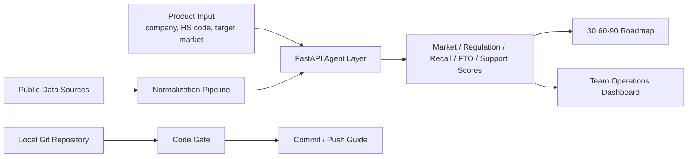

# GROW-GATE Local EX

> 지역 제조기업을 위한 수출 규제·인증 실행 AI 에이전트.
> 공공데이터를 시장성, 인증, 리콜, 특허/FTO, 지원사업, 30·60·90일 실행계획으로 연결하는 로컬 시연형 프로토타입입니다.


## New App (FE-02 / BE-02)

| Type | Path | Stack | Description |
| :--- | :--- | :--- | :--- |
| React FE | `frontend/FE-02/` | React 18 + Vite | [frontend/FE-02/README.md](frontend/FE-02/README.md) |
| Spring Boot BE | `backend/BE-02/` | Spring Boot 3.4 + MySQL | [backend/BE-02/README.md](backend/BE-02/README.md) |

## Timeline

| Date | Type | Description |
| :--- | :--- | :--- |
| 26.05.18 | 온라인 미팅 |  |
| 26.05.31 | 1차 스프린트 |  |
| 26.06.04 | 2차 스프린트 |  |
| 26.06.20 | 3차 스프린트 |  |

## Why

지역 제조기업은 제품을 해외에 팔기 전에 시장성보다 더 현실적인 질문에 막힙니다.

- 이 제품에 어떤 인증과 시험이 필요한가
- 유사 리콜 위험은 무엇인가
- 특허/FTO 리스크는 어디부터 봐야 하는가
- 지원사업으로 어떤 비용을 줄일 수 있는가
- 오늘부터 30일, 60일, 90일 동안 무엇을 해야 하는가

GROW-GATE Local EX는 이 질문을 공공데이터 기반 실행 보드로 바꿉니다.

## What It Does

| 영역 | 기능 |
| :--- | :--- |
| AI 진단 | 기업·제품·HS Code·대상국을 입력하면 수출 준비도와 실행 우선순위를 계산 |
| 공공데이터 파이프라인 | 관세청, KOTRA, Safety Korea, KIPRIS, 지원사업 데이터를 화면별 근거로 추적 |
| 실행 로드맵 | 30·60·90일 단위로 담당자, 산출물, 시험·인증 태스크를 정리 |
| 팀 운영실 | 데이터 활용도, 부족 데이터, 역할자별 기획 완성도, 입상 가능성, 개선 액션을 점수화 |
| 코드 게이트 | 리뷰 체크리스트, 커밋 전 확인, 로컬 Git 커밋, GitHub push 가이드를 제공 |

## Public Data Coverage

| Source | Target Table | Used For |
| :--- | :--- | :--- |
| 관세청 수출입무역통계 GW | `trade_signal` | HS Code·대상국 기반 시장성 점수 |
| KOTRA 글로벌 공급망 인사이트 | `country_profile` | 공급망 이슈, 바이어 요구, 국가별 로드맵 메모 |
| Safety Korea 제품 안전인증 및 리콜 정보 | `recall_case` | 유사 리콜 위험, 시험 전 체크리스트, FMEA 초안 |
| KIPRIS Plus Open API | `patent_signal` | BMS·보호회로·열관리 FTO 1차 위험지도 |
| 수출바우처·해외규격인증·지역TP 공고 | `support_program` | 인증 갭 기반 지원사업 추천 |

팀 운영실의 공공데이터 카드를 클릭하면 활용 내역, 실제 코드 연결, 데이터 형태, 간단 통계를 즉시 볼 수 있습니다.

## Screens

```text
grow_gate_local_ex_demo/frontend/
├─ index.html       # 홈
├─ workspace.html   # AI 진단 워크스페이스
├─ data.html        # 공공데이터 파이프라인
├─ roadmap.html     # 30·60·90일 실행 로드맵
├─ team.html        # 팀 운영실
└─ code-gate.html   # 코드 리뷰·커밋 게이트
```

## Quick Start

### 1. HTML만 열기

브라우저에서 아래 파일을 직접 열 수 있습니다.

```text
grow_gate_local_ex_demo/frontend/index.html
```

### 2. 정적 서버로 보기

```bash
cd grow_gate_local_ex_demo
.venv312/bin/python -m http.server 8765
```

Open:

```text
http://127.0.0.1:8765/frontend/index.html
```

### 3. FastAPI 백엔드 실행

```bash
cd grow_gate_local_ex_demo
.venv312/bin/python run_backend.py
```

API:

```text
GET  /health
GET  /datasets
GET  /pipeline/preview
GET  /public-data/sources
GET  /public-data/normalized
POST /public-data/collect
POST /analyze
POST /report
```

## Code Gate Git Bridge

`code-gate.html`은 FastAPI 백엔드가 켜져 있을 때 로컬 Git 작업을 요청할 수 있습니다. 보안상 기본값은 잠김입니다.

```bash
cd grow_gate_local_ex_demo
GROW_GATE_ENABLE_GIT_OPS=1 \
GROW_GATE_GIT_TOKEN="local-only-token" \
.venv312/bin/python run_backend.py
```

그 다음 `코드 게이트` 화면의 `실행 토큰` 칸에 같은 토큰을 입력합니다.

보안 정책:

- Git 실행 API는 localhost에서만 동작합니다.
- `GROW_GATE_ENABLE_GIT_OPS=1` 없이는 commit/push가 거부됩니다.
- commit/push/init은 `X-GrowGate-Git-Token` 헤더가 맞아야 실행됩니다.
- GitHub 인증 정보나 토큰은 저장하지 않습니다.
- push는 이 컴퓨터에 GitHub write 권한이 설정된 경우에만 성공합니다.

## Architecture



## Repository Layout

```text
grow_gate_local_ex_demo/
├─ backend/
│  ├─ app.py                  # FastAPI API, public-data endpoints, guarded Git bridge
│  ├─ agents.py               # Planner/Data/Market/Regulation/Recall/FTO/Support agents
│  ├─ public_data_pipeline.py # seed/live collection and normalization
│  ├─ ml_models.py            # scoring and prediction layer
│  └─ schemas.py              # Pydantic contracts
├─ data/
│  ├─ public_data_sources.json
│  └─ sample_datasets.json
├─ docs/
│  └─ architecture.md
├─ frontend/
│  ├─ team.html
│  ├─ code-gate.html
│  ├─ team.js
│  └─ styles.css
└─ tests/
   └─ test_agent.py
```

## Verification

```bash
cd grow_gate_local_ex_demo
.venv312/bin/python -m pytest
```

Expected:

```text
1 passed
```

## Current Demo Scenario

- 기업: 경남 배터리테크
- 제품: 리튬이온 배터리팩
- HS Code: 850760
- 대상국: Germany / EU
- 핵심 규제: UN38.3, IEC 62133, CE/LVD/EMC, EU Battery Passport

## Security Notes

This is a local prototype. The code includes guardrails for demo safety:

- CORS is restricted to known local origins.
- live public-data collection requires `GROW_GATE_ENABLE_LIVE_COLLECTION=1`.
- Git write operations require explicit env enablement and a local token.
- Frontend rendering escapes dynamic text before inserting HTML.
- GitHub credentials are never stored by the app.

## License 

See [LICENSE](LICENSE).
