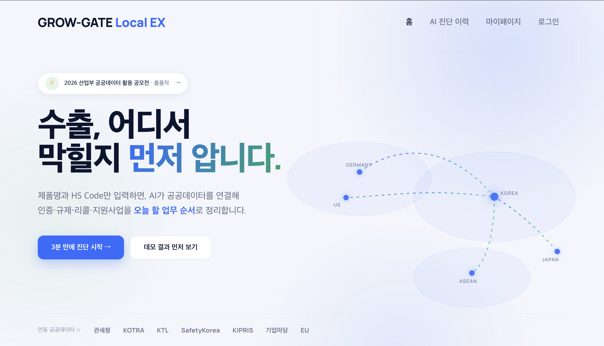
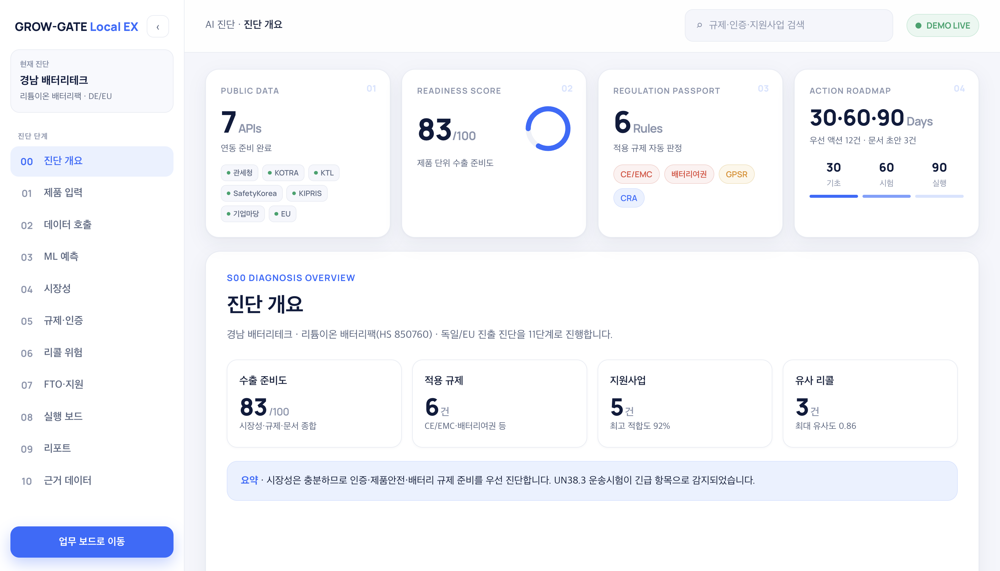
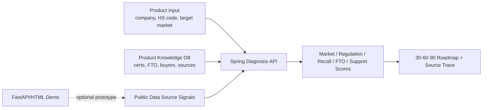

# GROW-GATE Local EX

> 지역 제조기업을 위한 수출 규제·인증 실행 진단 서비스.
> 제출용 메인 앱은 React FE-02 + Spring Boot BE-02이며, 제품·HS Code·대상국·제품 지식과 공공데이터 출처 신호를 수출 준비도와 30·60·90일 실행계획으로 연결합니다.


---

## Table of Contents

1. [Main App (FE-02 / BE-02)](#1-main-app-fe-02--be-02)
2. [Why](#2-why)
3. [What It Does](#3-what-it-does)
4. [Public Data Coverage](#4-public-data-coverage)
5. [Screens](#5-screens)
6. [Quick Start](#6-quick-start)
7. [Code Gate Git Bridge](#7-code-gate-git-bridge)
8. [Architecture](#8-architecture)
9. [Repository Layout](#9-repository-layout)
10. [Verification](#10-verification)
11. [Current Demo Scenario](#11-current-demo-scenario)
12. [Security Notes](#12-security-notes)
13. [License](#13-license)
14. [Timeline](#14-timeline)

---

## 1. Main App (FE-02 / BE-02)

| Type | Path | Stack | Description |
| :--- | :--- | :--- | :--- |
| React FE | `frontend/FE-02/` | React 18 + Vite | [frontend/FE-02/README.md](frontend/FE-02/README.md) |
| Spring Boot BE | `backend/BE-02/` | Spring Boot 3.4 + MySQL | [backend/BE-02/README.md](backend/BE-02/README.md) |

최근 제출 보완 내역은 [docs/submission-update-report.md](docs/submission-update-report.md)에 정리했습니다. 첨부 평가 항목별 완료/미완료 판정은 [docs/evaluation-resolution-status.md](docs/evaluation-resolution-status.md)에서 확인할 수 있습니다.

| 홈 | AI 진단 결과 |
| :--- | :--- |
|  |  |

---

## 2. Why

지역 제조기업은 제품을 해외에 팔기 전에 시장성보다 더 현실적인 질문에 막힙니다.

- 이 제품에 어떤 인증과 시험이 필요한가
- 유사 리콜 위험은 무엇인가
- 특허/FTO 리스크는 어디부터 봐야 하는가
- 지원사업으로 어떤 비용을 줄일 수 있는가
- 오늘부터 30일, 60일, 90일 동안 무엇을 해야 하는가

GROW-GATE Local EX는 이 질문을 공공데이터 기반 실행 보드로 바꿉니다.

---

## 3. What It Does

| 영역 | 기능 |
| :--- | :--- |
| 진단 실행 | 기업·제품·HS Code·대상국을 입력하면 Spring API가 실제 진단 run을 생성하고 결과 id로 이동 |
| 규칙 기반 스코어링 | HS Code, 대상국, 인증 만료, FTO 위험, 바이어 요구사항, 지식 신뢰도, 출처 수를 점수에 반영 |
| 공공데이터 근거 추적 | 관세청, KOTRA, Safety Korea, KIPRIS, 지원사업 live/cache/fallback 수집 record를 `sourceId`, `matchedKey`, `usedFor`, `scoreContribution`으로 반환 |
| 실행 로드맵 | 30·60·90일 단위로 담당자, 산출물, 시험·인증 태스크를 정리 |
| 팀 운영실 | 데이터 활용도, 부족 데이터, 역할자별 기획 완성도, 입상 가능성, 개선 액션을 점수화 |
| 코드 게이트 | 리뷰 체크리스트, 커밋 전 확인, 로컬 Git 커밋, GitHub push 가이드를 제공 |

---

## 4. Public Data Coverage

| Source | Current Implementation | Used For |
| :--- | :--- | :--- |
| 관세청 수출입무역통계 GW | 기본 endpoint `http://apis.data.go.kr/1220000/Newtrade/getNewtradeList`, `KCS_TRADE_API_KEY` 또는 `DATAGO_SERVICE_KEY`로 live 수집 | 시장성 점수 contribution |
| KOTRA 글로벌 공급망 인사이트 | 기본 공식 카탈로그 `https://www.data.go.kr/data/15122648/openapi.do`, 승인 후 `KOTRA_MARKET_API_URL`에 operation endpoint 설정 | 국가별 실행 메모와 지원 적합도 |
| Safety Korea 제품 안전인증 및 리콜 정보 | 기본 공식 안내 `https://www.safetykorea.kr/release/openapi`, 실제 operation endpoint 설정 시 live 수집 | 규제·리콜 점수 contribution |
| KIPRIS Plus Open API | 기본 공식 신청 페이지 `https://plus.kipris.or.kr/eng/main/contents.do?menuNo=300024`, `KIPRIS_API_KEY` 또는 `KIPRIS_PLUS_KEY` 사용 | 특허/FTO 점수 contribution |
| 기업마당·지원사업 | 기본 공식 포털 `https://www.exportvoucher.com/`, 실제 operation endpoint 설정 시 live 수집 | 지원사업/실행 가능성 점수 |

현재 제출용 Spring 앱은 API key와 실제 호출 endpoint가 있으면 live 공공 API를 호출하고, key가 없거나 호출이 실패하면 `public_data_collection_runs`, `public_data_records`에 fallback 사유를 저장합니다. 공식 카탈로그/신청 페이지 URL은 출처 추적용 기본값으로 보존하되, HTML 상세 페이지를 API 응답으로 저장하지 않도록 fallback 처리합니다. 메인 진단 결과에는 live/cache/fallback 여부와 점수 기여도가 표시됩니다.

---

## 5. Screens

```text
grow_gate_local_ex_demo/frontend/
├─ index.html       # 홈
├─ workspace.html   # AI 진단 워크스페이스
├─ data.html        # 공공데이터 파이프라인
├─ roadmap.html     # 30·60·90일 실행 로드맵
├─ team.html        # 팀 운영실
└─ code-gate.html   # 코드 리뷰·커밋 게이트
```

---

## 6. Quick Start

### 1. 제출용 메인 앱 실행

Spring Boot와 React를 함께 실행합니다.

```bash
cd backend/BE-02
export DB_PASSWORD=your_local_db_password
export JWT_SECRET=$(openssl rand -base64 32)
export JPA_DDL_AUTO=update   # 빈 로컬 DB에서 빠르게 실행할 때만 사용. 제출/운영 기본값은 validate
export PUBLIC_DATA_ENABLED=true
./gradlew bootRun
```

```bash
cd frontend/FE-02
npm install
npm run dev
```

Open:

```text
http://localhost:5173
```

### 2. 보조 정적 데모 보기

```bash
cd grow_gate_local_ex_demo
.venv312/bin/python -m http.server 8765
```

Open:

```text
http://127.0.0.1:8765/frontend/index.html
```

### 3. FastAPI 백엔드 실행

```bash
cd grow_gate_local_ex_demo
.venv312/bin/python run_backend.py
```

API:

```text
GET  /health
GET  /datasets
GET  /pipeline/preview
GET  /public-data/sources
GET  /public-data/normalized
POST /public-data/collect
GET  /public-data/runs
GET  /public-data/records
POST /analyze
POST /report
```

Spring 메인 앱에서 FastAPI agent/report bridge를 함께 쓰려면 FastAPI를 먼저 실행한 뒤 Spring 환경변수에 아래 값을 추가합니다.

```bash
export APP_FASTAPI_ENABLED=true
export APP_FASTAPI_BASE_URL=http://localhost:8000
```

---

## 7. Code Gate Git Bridge

`code-gate.html`은 FastAPI 백엔드가 켜져 있을 때 로컬 Git 작업을 요청할 수 있습니다. 보안상 기본값은 잠김입니다.

```bash
cd grow_gate_local_ex_demo
GROW_GATE_ENABLE_GIT_OPS=1 \
GROW_GATE_GIT_TOKEN="local-only-token" \
.venv312/bin/python run_backend.py
```

그 다음 `코드 게이트` 화면의 `실행 토큰` 칸에 같은 토큰을 입력합니다.

보안 정책:

- Git 실행 API는 localhost에서만 동작합니다.
- `GROW_GATE_ENABLE_GIT_OPS=1` 없이는 commit/push가 거부됩니다.
- commit/push/init은 `X-GrowGate-Git-Token` 헤더가 맞아야 실행됩니다.
- GitHub 인증 정보나 토큰은 저장하지 않습니다.
- push는 이 컴퓨터에 GitHub write 권한이 설정된 경우에만 성공합니다.

---

## 8. Architecture



---

## 9. Repository Layout

```text
grow_gate_local_ex_demo/
├─ backend/
│  ├─ app.py                  # FastAPI API, public-data endpoints, guarded Git bridge
│  ├─ agents.py               # Planner/Data/Market/Regulation/Recall/FTO/Support agents
│  ├─ public_data_pipeline.py # seed/live collection and normalization
│  ├─ ml_models.py            # scoring and prediction layer
│  └─ schemas.py              # Pydantic contracts
├─ data/
│  ├─ public_data_sources.json
│  └─ sample_datasets.json
├─ docs/
│  └─ architecture.md
├─ frontend/
│  ├─ team.html
│  ├─ code-gate.html
│  ├─ team.js
│  └─ styles.css
└─ tests/
   └─ test_agent.py
```

---

## 10. Verification

```bash
cd grow_gate_local_ex_demo
.venv312/bin/python -m pytest
```

Expected:

```text
1 passed
```

---

## 11. Current Demo Scenario

- 기업: 경남 배터리테크
- 제품: 리튬이온 배터리팩
- HS Code: 850760
- 대상국: Germany / EU
- 핵심 규제: UN38.3, IEC 62133, CE/LVD/EMC, EU Battery Passport

---

## 12. Security Notes

This is a local prototype. The code includes guardrails for demo safety:

- CORS is restricted to known local origins.
- live public-data collection requires `GROW_GATE_ENABLE_LIVE_COLLECTION=1`.
- Git write operations require explicit env enablement and a local token.
- Frontend rendering escapes dynamic text before inserting HTML.
- GitHub credentials are never stored by the app.

---

## 13. License

See [LICENSE](LICENSE).

---

## 14. Timeline

| Date | Type | Description |
| :--- | :--- | :--- |
| 26.05.18 | 온라인 미팅 |  |
| 26.05.31 | 1차 스프린트 |  |
| 26.06.04 | 2차 스프린트 |  |
| 26.06.20 | 3차 스프린트 |  |

---
