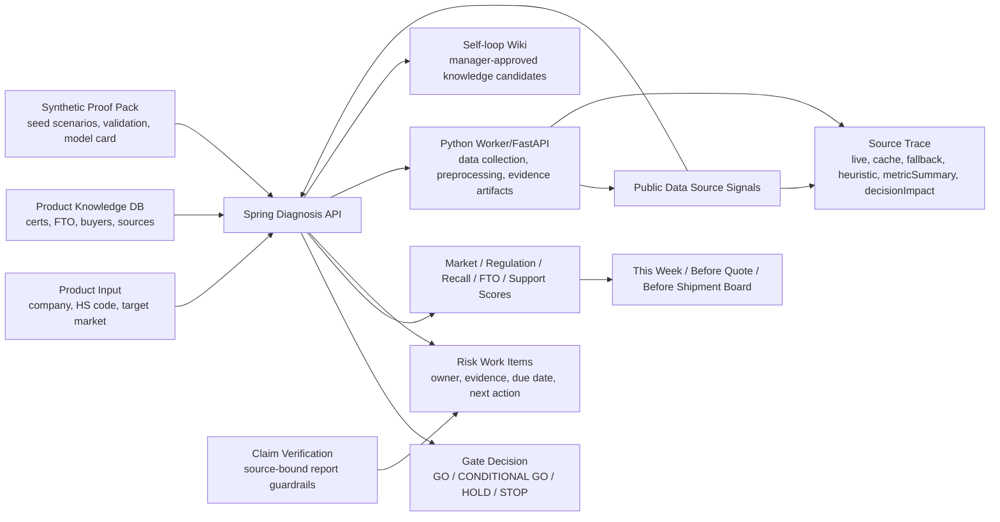

# GROW-GATE Local EX

> 지역 제조기업을 위한 바이어 문의 기반 수출 Gate 판단 서비스.
> 제출용 메인 앱은 React FE-02 + Spring Boot BE-02이며, 제품·HS Code·대상국·바이어 요구사항·제품 지식과 공공데이터 출처 신호를 GO/CONDITIONAL GO/HOLD/STOP 판단과 업무 보드로 연결합니다.


---

## Table of Contents

1. [Main App (FE-02 / BE-02)](#1-main-app-fe-02--be-02)
2. [Why](#2-why)
3. [What It Does](#3-what-it-does)
4. [Public Data Coverage](#4-public-data-coverage)
5. [Screens](#5-screens)
6. [Quick Start](#6-quick-start)
7. [Code Gate Git Bridge](#7-code-gate-git-bridge)
8. [Architecture](#8-architecture)
9. [Repository Layout](#9-repository-layout)
10. [Verification](#10-verification)
11. [Current Demo Scenario](#11-current-demo-scenario)
12. [Deployment Status](#12-deployment-status)
13. [Security Notes](#13-security-notes)
14. [License](#14-license)
15. [Timeline](#15-timeline)

---

## 1. Main App (FE-02 / BE-02)

| Type | Path | Stack | Description |
| :--- | :--- | :--- | :--- |
| React FE | `frontend/FE-02/` | React 18 + Vite | [frontend/FE-02/README.md](frontend/FE-02/README.md) |
| Spring Boot BE | `backend/BE-02/` | Spring Boot 3.4 + MySQL | [backend/BE-02/README.md](backend/BE-02/README.md) |

최근 제출 보완 내역은 [docs/submission-update-report.md](docs/submission-update-report.md)에 정리했습니다. 첨부 평가 항목별 완료/미완료 판정은 [docs/evaluation-resolution-status.md](docs/evaluation-resolution-status.md)에서 확인할 수 있습니다. 팀 공유용 업데이트 요약은 [docs/team-update-2026-06-30-submission-hardening.md](docs/team-update-2026-06-30-submission-hardening.md)에 별도로 정리했습니다.

심사용 합성 데이터팩 적용 정책은 [docs/SYNTHETIC_DATA_POLICY.md](docs/SYNTHETIC_DATA_POLICY.md), 3개 seed 시나리오 계정과 진단 ID는 [docs/demo-scenarios.md](docs/demo-scenarios.md), 제출 범위와 zip 제외 기준은 [SUBMISSION_SCOPE.md](SUBMISSION_SCOPE.md)에 고정했습니다. 합성 데이터는 반드시 `synthetic_demo_not_real_customer`로 설명하며, live 공공 API proof로 계산하지 않습니다.

실제 공공 API 증거는 `/api/admin/public-data/proof-runs`가 생성하는 `proofRunId`, `rawResponseSha256`, `schemaValidationStatus`, `operationEndpoint`, `apiKeyConfigured` 기준으로만 인정합니다. Synthetic persona validation은 [docs/validation/README_SYNTHETIC_VALIDATION.md](docs/validation/README_SYNTHETIC_VALIDATION.md)에 분리했고, 실제 고객 인터뷰로 표현하지 않습니다. 보고서 공식 산출물은 Markdown이며 PDF는 [docs/report/REPORT_FORMAT_POLICY.md](docs/report/REPORT_FORMAT_POLICY.md)의 선택 인쇄/변환 전략만 사용합니다. Pilot ML artifact는 `python3 ml/pipelines/train_all.py`로 생성하며 `/api/ml/models/latest`에서 버전과 한계를 조회합니다.

2026-07-04 기준 GitHub `main`에는 심사용 방어 패키지가 포함되어 있습니다.

- 3개 합성 seed 기업, 지역산업 profile, agent trace event schema, synthetic persona validation
- public-data proof run API와 S10 proof surface
- raw response hash, schema validation status, live/cache/fallback waterfall
- Markdown report policy와 proof pack 생성/검증 스크립트
- synthetic rule-assisted ML artifact와 `/api/ml/models/latest` 제한 고지
- `scripts/check-risk-gates.sh` 기반 제출 리스크 회귀 차단

심사 대응 기준 문서는 [docs/top15-resolution-2026-07-01.md](docs/top15-resolution-2026-07-01.md)입니다. 15개 치명 항목의 처리 상태, code reference, 남은 상용화 과제를 이 문서에 고정했습니다.
90점권 시연 증거 기준은 [docs/judge-defense-90.md](docs/judge-defense-90.md), 공공데이터 metric/score 매핑은 [docs/public-data-field-mapping.md](docs/public-data-field-mapping.md), 발표 서버 환경 변수 템플릿은 [.env.example.presentation](.env.example.presentation)에 정리했습니다.

| 홈 | 수출 Gate 판단 결과 |
| :--- | :--- |
|  |  |

---

## 2. Why

지역 제조기업은 제품을 해외에 팔기 전에 시장성보다 더 현실적인 질문에 막힙니다.

- 이 제품에 어떤 인증과 시험이 필요한가
- 유사 리콜 위험은 무엇인가
- 특허/FTO 리스크는 어디부터 봐야 하는가
- 지원사업으로 어떤 비용을 줄일 수 있는가
- 견적 전, 출하 전 어떤 근거와 문서를 확보해야 하는가

GROW-GATE Local EX는 이 질문을 바이어 회신 가능한 Gate 판단과 담당자 업무 보드로 바꿉니다.

---

## 3. What It Does

| 영역 | 기능 |
| :--- | :--- |
| Gate 판단 실행 | 기업·제품·HS Code·대상국·바이어 문의를 입력하면 Spring API가 실제 판단 run을 생성하고 결과 id로 이동 |
| 규칙 기반 스코어링 | HS Code, 대상국, 인증 만료, FTO 위험, 바이어 요구사항, 지식 신뢰도, 출처 수를 점수에 반영 |
| 공공데이터 근거 추적 | 관세청, KOTRA, Safety Korea, KIPRIS, 지원사업의 live/cache/fallback 수집 상태와 metric 기반 contribution을 `sourceId`, `matchedKey`, `usedFor`, `confidenceAdjustedContribution`으로 반환 |
| 안전 공개 웹 크롤링 | API가 없거나 보조 근거가 필요한 경우, 명시된 HTTPS allowlist URL만 수집해 마스킹/전처리 후 `sourceType=crawl`로 적재 |
| source-bound evidence retrieval | 제품 지식, 담당자 문서, 공공데이터 record, 승인된 loop 항목을 출처가 묶인 top-k evidence chunk로 검색 |
| export knowledge timeline | sourceId, sourceType, fetchedAt, publishedAt/sourcePeriod, scoreImpact를 분리해 “언제 수집한 어떤 근거가 점수에 영향 줬는지” 표시 |
| self-loop wiki 근거화 | 제품 지식, 인증, FTO, 바이어 요구, 공공데이터 record를 chunk화하고 담당자 승인 지식화 후보를 다음 판단 context에 재사용 |
| Workflow trace | Spring `AgentLoop`가 plan, tool call, observation, verifier, retry, fallback, complete task를 기록 |
| Decision Brief | 결과 첫 화면에서 Gate 판단, 핵심 위험 3개, `오늘 할 일`/`이번 주 할 일`/`외부기관 문의` 3개 행동을 먼저 표시 |
| Gate 업무 보드 | 이번 주, 견적 전, 출하 전 단위로 담당자, 산출물, 시험·인증 태스크를 정리 |
| 팀 운영실 | 데이터 활용도, 부족 데이터, 역할자별 기획 완성도, 입상 가능성, 개선 액션을 점수화 |
| 코드 게이트 | 리뷰 체크리스트, 커밋 전 확인, 로컬 Git 커밋, GitHub push 가이드를 제공 |

---

## 4. Public Data Coverage

| Source | Current Implementation | Used For |
| :--- | :--- | :--- |
| 관세청 수출입무역통계 GW | 기본 endpoint `http://apis.data.go.kr/1220000/Newtrade/getNewtradeList`, `KCS_TRADE_API_KEY` 또는 `DATAGO_SERVICE_KEY`로 live 수집 | 시장성 점수 contribution |
| KOTRA 글로벌 공급망 인사이트 | 기본 공식 카탈로그 `https://www.data.go.kr/data/15122648/openapi.do`, 승인 후 `KOTRA_MARKET_API_URL`에 operation endpoint 설정 | 시장성·국가별 실행 신호 contribution |
| Safety Korea 제품 안전인증 및 리콜 정보 | 기본 공식 안내 `https://www.safetykorea.kr/release/openapi`, 실제 operation endpoint 설정 시 live 수집 | 규제·리콜 점수 contribution |
| KIPRIS Plus Open API | 기본 공식 신청 페이지 `https://plus.kipris.or.kr/eng/main/contents.do?menuNo=300024`, `KIPRIS_API_KEY` 또는 `KIPRIS_PLUS_KEY` 사용 | 특허/FTO 점수 contribution |
| 기업마당·지원사업 | 기본 공식 포털 `https://www.exportvoucher.com/`, 실제 operation endpoint 설정 시 live 수집 | 지원사업/실행 가능성 점수 |

현재 제출용 Spring 앱은 `PUBLIC_DATA_ENABLED=true`가 기본값입니다. API key와 실제 operation endpoint가 있으면 live 공공 API를 호출하고, key가 없거나 호출이 실패하면 `public_data_collection_runs`, `public_data_records`에 fallback 사유를 저장합니다. 공식 카탈로그/신청 페이지 URL은 출처 추적용 기본값으로 보존하되, HTML 상세 페이지를 API 응답으로 저장하지 않도록 fallback 처리합니다. 메인 진단 결과에는 `live`, `cache`, `fallback`, `heuristic`, `agent` sourceType과 confidence-adjusted 점수 기여도, provider별 metric signal이 표시됩니다. 여기서 `agent`는 점수 산출 주체가 아니라 선택형 분석 bridge와 workflow trace를 나타내는 보조 출처입니다.

발표장에서 공식 live 공공 API 증거로 설명할 수 있는 record는 `sourceType=live/cache`, `operationEndpoint=true`, `apiKeyConfigured=true`, `collectionRunId`, `fetchedAt/retrievedAt`, `metricSummary/metrics`가 함께 있어야 합니다. S10 화면과 `/diagnosis/{id}/sources` 화면은 이 값을 직접 표시하고, `fallback`, `crawl`, `external_feed`, `heuristic`은 공식 API 연결 성공으로 표시하지 않습니다.

공식 proof run은 기존 `public_data_records`를 재가공해 별도 proof table에 저장합니다.

| Proof Artifact | Purpose |
| :--- | :--- |
| `public_api_proof_runs` | 진단 단위 proof run id, provider count, live/cache/fallback count, MOTIE-related count |
| `public_api_raw_responses` | provider, redacted request URL, raw response SHA-256, schema validation status |
| `public_api_normalized_records` | provider별 normalized metric과 source type |
| `public_data_score_contributions` | raw metric → normalized metric → raw contribution → confidence-adjusted contribution waterfall |

`scripts/build-proof-pack.sh`는 로컬 proof pack을 생성하고, `scripts/check-proof-pack.sh`는 배포 서버에서 export한 live proof JSON이 없으면 의도적으로 실패합니다. 이 실패는 코드 오류가 아니라 “실제 배포 서버 proof를 아직 첨부하지 않았다”는 제출 방어 장치입니다.

필요할 때만 `PUBLIC_DATA_CRAWL_ENABLED=true`와 `PUBLIC_DATA_CRAWL_URLS=https://...`를 설정해 산업부/KOTRA/SafetyKorea 등 allowlist 공개 페이지를 보조 근거로 수집할 수 있습니다. 크롤링 결과는 script/style 제거, 개인정보/키 패턴 마스킹, 길이 제한, keyword metric 전처리를 거친 뒤 `sourceType=crawl`로 표시되며, 공공 API live record와 구분됩니다.

벡터 DB 기반 대규모 검색 또는 성과 확률 산출이라고 주장하지 않습니다. 제출 서버의 현재 구현은 DB 지식과 공공데이터 record를 chunk화한 뒤 담당자가 승인한 self-loop wiki 항목을 다음 판단 context에 재사용하고, `evidenceRetrieval`, `exportKnowledgeTimeline`, `evidenceGuardrails`로 근거 범위와 fallback 정책을 화면에 드러내는 방식입니다. 대규모 문서 검색은 pgvector/Redis 등으로 교체 가능한 후속 과제입니다.

---

## 5. Screens

제출 판단 대상 화면은 `frontend/FE-02` React 앱입니다. 과거 정적 HTML 데모와 개발용 mock fixture는 심사 혼동을 막기 위해 저장소의 실행 경로에서 제거했고, 복구가 필요한 경우에만 `artifacts/legacy-backups/legacy-demo-and-mock-backup-2026-07-03.zip`에서 확인합니다. 제출 zip 생성 스크립트는 이 백업 zip도 제외합니다.

```text
frontend/FE-02/src/
├─ pages/auth/Home.jsx                 # Before/After와 진입 화면
├─ pages/diagnosis/DiagnosisNew.jsx    # 제품 + 바이어 문의 입력
├─ pages/diagnosis/DiagnosisResult.jsx # Gate 판단, Source Trust Bar, stage cards
├─ components/diagnosis/S10Sources.jsx # live/cache/fallback 출처와 contribution ledger
└─ services/diagnosisService.js        # Spring API response mapper
```

---

## 6. Quick Start

### 1. 제출용 메인 앱 실행

Spring Boot와 React를 함께 실행합니다.

```bash
cd backend/BE-02
export DB_PASSWORD=your_local_db_password
export JWT_SECRET=$(openssl rand -base64 32)
export JPA_DDL_AUTO=update   # 빈 로컬 DB에서 빠르게 실행할 때만 사용. 제출/운영 기본값은 validate
export PUBLIC_DATA_ENABLED=true
./gradlew bootRun
```

```bash
cd frontend/FE-02
npm install
npm run dev
```

Open:

```text
http://localhost:5173
```

### 2. Python 데이터/AI Worker 실행

`grow_gate_local_ex_demo`는 더 이상 정적 데모가 아니라 Spring 메인 앱이 선택적으로 호출하는 Python 데이터/AI worker입니다. 공공데이터 응답 정규화, evidence compile, source-bound claim verification, bounded planning/tool/verification/retry loop를 담당합니다.

```bash
cd grow_gate_local_ex_demo
.venv312/bin/python run_backend.py
```

API:

```text
GET  /health
POST /worker/diagnosis-v1
```

Spring 메인 앱에서 Python worker bridge를 함께 쓰려면 worker를 먼저 실행한 뒤 Spring 환경변수에 아래 값을 추가합니다. worker가 꺼져 있어도 Spring의 rule scoring과 source-traced 결과는 동작합니다.

```bash
export APP_FASTAPI_ENABLED=true
export APP_FASTAPI_BASE_URL=http://localhost:8000
```

---

## 7. Code Gate Git Bridge

`code-gate.html`은 FastAPI 백엔드가 켜져 있을 때 로컬 Git 작업을 요청할 수 있습니다. 보안상 기본값은 잠김입니다.

```bash
cd grow_gate_local_ex_demo
GROW_GATE_ENABLE_GIT_OPS=1 \
GROW_GATE_GIT_TOKEN="local-only-token" \
.venv312/bin/python run_backend.py
```

그 다음 `코드 게이트` 화면의 `실행 토큰` 칸에 같은 토큰을 입력합니다.

보안 정책:

- Git 실행 API는 localhost에서만 동작합니다.
- `GROW_GATE_ENABLE_GIT_OPS=1` 없이는 commit/push가 거부됩니다.
- commit/push/init은 `X-GrowGate-Git-Token` 헤더가 맞아야 실행됩니다.
- GitHub 인증 정보나 토큰은 저장하지 않습니다.
- push는 이 컴퓨터에 GitHub write 권한이 설정된 경우에만 성공합니다.

---

## 8. Architecture



---

## 9. Repository Layout

```text
backend/BE-02/
├─ src/main/java/com/growgate/diagnosis/
│  ├─ service/DiagnosisAsyncProcessor.java   # Gate 판단, scoring, source trace, report memo
│  ├─ dto/CreateDiagnosisRequest.java        # 제품 + 바이어 문의 입력 계약
│  └─ dto/DiagnosisDetailResponse.java       # gateDecision, confidencePanel, actionRoadmap
├─ src/main/java/com/growgate/agent/         # bounded workflow trace event 조회
├─ src/main/java/com/growgate/ml/            # synthetic ML artifact metadata endpoint
├─ src/main/java/com/growgate/publicdata/
│  ├─ service/PublicDataCollectionService.java
│  ├─ service/PublicDataProofRunService.java
│  └─ service/PublicDataDailyRefreshService.java
├─ src/main/java/com/growgate/regional/      # 지역산업 profile 매칭
└─ src/main/resources/application.yml

frontend/FE-02/
├─ src/pages/auth/Home.jsx                   # Before/After와 Gate Decision 첫 화면
├─ src/pages/diagnosis/DiagnosisNew.jsx      # 제품 + 바이어 문의 입력
├─ src/pages/diagnosis/DiagnosisResult.jsx   # Gate 판단 결과 뷰어
├─ src/components/diagnosis/GateDecisionHero.jsx
├─ src/components/diagnosis/S08ExecBoard.jsx # 이번 주/견적 전/출하 전 업무 보드
└─ src/services/diagnosisService.js          # BE response mapper

scripts/
├─ check-risk-gates.sh                       # 제출 리스크 CI gate
├─ build-proof-pack.sh                       # proof pack 생성
├─ check-proof-pack.sh                       # 배포 서버 proof 존재 검증
├─ package-submission.sh                     # 제출 zip 생성, legacy/demo/archive 제외
├─ verify-local.sh                           # 로컬 재현 검증
└─ smoke-prod.sh                             # 배포 서버 smoke test

database/mysql/init/
├─ 03_agent_ml_regional_schema.sql
├─ 04_seed_regional_and_registry.sql
├─ 05_seed_synthetic_companies.sql
├─ 06_public_api_proof_ml_validation.sql
└─ 07_seed_synthetic_persona_validation.sql

grow_gate_local_ex_demo/                     # Python 데이터/AI worker
ml/                                          # synthetic rule-assisted ML artifact pipeline
docs/proofs/                                 # generated proof pack placeholder/export target
docs/validation/                             # synthetic persona validation, not real interviews
```

---

## 10. Verification

```bash
./scripts/check-risk-gates.sh
./scripts/build-proof-pack.sh
./scripts/package-submission.sh
./scripts/verify-fresh-db.sh
cd backend/BE-02 && ./gradlew test --no-daemon
cd frontend/FE-02 && npm run test:mappers && npm run build
```

`verify-fresh-db.sh`는 별도 Docker Compose project로 clean MySQL을 띄우고 `JPA_DDL_AUTO=validate`로 백엔드 health까지 확인합니다. 기존 로컬 DB volume은 사용하지 않습니다.

배포 서버 proof pack 검증:

```bash
./scripts/check-proof-pack.sh
```

이 명령은 `docs/proofs/public-data/latest/public-data-proof-run.json`이 실제 배포 서버에서 export된 proof run을 포함해야 통과합니다. placeholder 상태에서는 실패해야 정상입니다.

배포 서버 smoke test:

```bash
BASE_URL=https://your-domain.example ./scripts/smoke-prod.sh
```

완료된 진단 1건에 대해 operation endpoint/API key evidence까지 발표용 JSON으로 캡처:

```bash
BASE_URL=https://your-domain.example \
DIAGNOSIS_ID=<completed-diagnosis-id> \
AUTH_TOKEN=<jwt-from-login-response> \
PRESENTATION_REQUIRE_LIVE_PUBLIC_DATA=true \
PRESENTATION_REQUIRE_OPERATION_API=true \
./scripts/presentation-public-data-proof.sh
```

---

## 11. Current Demo Scenario

합성 seed 시연 계정은 모두 `growgateadmin` 비밀번호를 사용합니다.

| Scenario | Login | Diagnosis ID | Gate |
| :--- | :--- | :--- | :--- |
| 창원 배터리팩 | `owner+battery@growgate.local` | `2b52340c-d51d-50dc-b6cb-592627abb62d` | `HOLD` |
| 부산 마린 액추에이터 | `owner+marine@growgate.local` | `6bc9800e-755c-55f9-b9ce-87a69dc2c450` | `CONDITIONAL_GO` |
| 대구 메디센서 | `owner+medical@growgate.local` | `cf7d23b4-51d8-53f7-be26-a92bf6682a6d` | `STOP` |

이 세 케이스는 `synthetic_demo_not_real_customer`입니다. S10에서 `seedCount`로 표시되며, `liveCount/cacheCount`와 공식 operation endpoint proof를 올리지 않습니다.

시연 산출물: Gate Decision, confidence panel, Source Trust Bar, S10 evidence ledger, 이번 주/견적 전/출하 전 업무 보드, Markdown 바이어 대응 메모.

---

## 12. Deployment Status

GitHub `main`은 최신 심사 방어 코드가 반영된 기준 브랜치입니다. Lightsail에는 HTTPS 서비스가 올라가 있으나, 서버 SSH 배포는 현재 인스턴스 인증키 등록이 필요합니다.

| Item | Current State |
| :--- | :--- |
| GitHub main | 최신 proof workflow 커밋 반영 |
| Lightsail static IP | `54.180.56.24` |
| Current public URL | `https://growgate.54.180.56.24.sslip.io` |
| Attached instance | `growgate-fresh-20260703-2134` |
| SSH firewall | 현재 작업자 IP allowlist와 Lightsail Connect 허용 |
| SSH auth | 로컬 public key를 서버 `~/.ssh/authorized_keys`에 추가해야 배포 가능 |
| Live public API proof | 서버에 operation endpoint/API key 주입 후 smoke와 proof export 필요 |

배포 재개 순서:

```bash
git pull origin main
cd backend/BE-02 && ./gradlew test bootJar --no-daemon
cd ../../frontend/FE-02 && npm ci && npm run build
sudo systemctl restart growgate-backend
sudo systemctl reload nginx
BASE_URL=https://growgate.54.180.56.24.sslip.io ./scripts/smoke-prod.sh
```

`PUBLIC_DATA_ENABLED=true`는 기본값이지만, `SMOKE_REQUIRE_LIVE_PUBLIC_DATA=true`는 실제 provider operation endpoint와 API key가 서버에 주입된 뒤에만 사용합니다.

---

## 13. Security Notes

제출용 메인 앱은 다음 보안 기본값을 적용합니다.

- JWT access token은 HttpOnly cookie 경로를 사용하고, legacy localStorage token 저장을 CI risk gate에서 차단합니다.
- Cookie 인증 요청은 `X-GG-CSRF` double-submit header를 사용합니다.
- CSRF 설계와 테스트 범위는 [docs/security-csrf-rate-limit-threat-model-2026-07-03.md](docs/security-csrf-rate-limit-threat-model-2026-07-03.md)에 정리되어 있습니다.
- CORS origin은 환경변수로 제한합니다.
- 공공데이터 run/record 조회는 user/company scope로 제한합니다.
- 공공 API/LLM key는 환경변수 또는 secret manager로만 주입하고 repository에 저장하지 않습니다.
- Gemini/OpenRouter 보조 추론은 기본 비활성화(`APP_AGENT_ENABLED=false`)이며, 활성화 시에도 사용자별/전체 일일 호출량, prompt 크기, output token 상한을 서버에서 강제합니다.
- 회원가입은 서비스 이용약관 필수 동의, 개인정보 수집·이용 필수 동의, 마케팅 선택 동의를 분리하고 `user_consent_records`에 정책 버전과 선택 내역을 저장합니다.
- Google Sign-In은 제출 서버 기본값에서 비활성화(`GOOGLE_SSO_ENABLED=false`)합니다. 정식 도메인, OAuth consent screen, 개인정보 처리방침 URL, 서버측 ID token 검증이 준비된 release에서만 켭니다.
- 현재 제출 서버는 결제/환불 기능을 제공하지 않습니다. 유료화 시에는 결제 API, 환불 정책, 정산 로그, 관리자 승인 flow를 별도 release gate로 추가해야 합니다.
- fallback 공공데이터는 `sourceType=fallback`으로 표시되며 점수를 올리지 않습니다.
- 로그인 실패 제한은 단일 Lightsail 제출 서버용 in-memory limiter입니다. 다중 인스턴스 상용 배포 전에는 Redis/shared TTL store로 교체합니다.
- `scripts/check-risk-gates.sh`가 실제 구현보다 앞서는 예측 모델 표현, S04~S07 mock 회귀, 비기능 버튼, Decision Brief 누락, scope 누락, LLM 예산 가드 누락, raw API key 커밋, smoke test 누락을 차단합니다.

---

## 14. License

See [LICENSE](LICENSE).

---

## 15. Timeline

| Date | Type | Description |
| :--- | :--- | :--- |
| 26.05.18 | 온라인 미팅 |  |
| 26.05.31 | 1차 스프린트 |  |
| 26.06.04 | 2차 스프린트 |  |
| 26.06.20 | 3차 스프린트 |  |

---
