# GROW-GATE Local EX End-to-End 사용 매뉴얼

이 문서는 2026-07-06에 운영 URL `https://growgate.54.180.56.24.sslip.io/`에서 실제 브라우저로 캡처한 화면을 기준으로 작성했습니다.

- 사용 계정: `owner+battery@growgate.local`
- 실행 진단 ID: `f70c509a-5e18-4d8f-a563-22511819b654`
- 리포트 proofRunId: `b331d870-3454-441c-a5a8-85ffff6a29e9`
- 주의: 캡처에 사용한 제품/계정은 `synthetic_demo_not_real_customer` 시연 데이터입니다. 실제 고객 데이터가 아니며, live/cache/fallback 공공데이터 근거와 구분해서 설명해야 합니다.

## 1. 서비스 목적

GROW-GATE Local EX는 지역 제조기업이 해외 바이어 문의를 받았을 때, 견적을 바로 확정하기 전에 확인해야 할 시장성, 규제·인증, 리콜·제품안전, FTO/특허, 지원사업, 실행 업무를 한 흐름으로 정리하는 서비스입니다.

대상 사용자는 수출 경험이 부족하거나, 공공데이터 포털·인증기관·특허 검색·지원사업 공고를 각각 따로 확인하기 어려운 제조기업 담당자입니다. 사용자는 제품명, HS Code, 대상국, 바이어 문의 내용을 입력하고, 시스템은 rule-based Gate 판단과 source-bound evidence를 바탕으로 다음 내용을 보여줍니다.

- 시장성: 대상국과 HS Code 기준 수출·시장 신호를 확인합니다.
- 규제·인증: CE, 배터리 규제, 제품안전, 보유 문서와 누락 문서를 사전 점검합니다.
- 리콜·제품안전: 유사 제품 리콜/위해정보를 확인하고 품질 체크리스트로 연결합니다.
- FTO/특허: KIPRIS/공개 특허 기반 사전 위험 신호를 확인합니다. 법률 의견은 아닙니다.
- 지원사업: KOTRA, 기업마당 등 지원사업 후보를 원문 확인 대상으로 정리합니다.
- 실행보드: 이번 주, 견적 전, 출하 전으로 업무와 산출물을 나눕니다.
- 리포트: 내부 회의와 바이어 회신 초안에 쓸 Markdown 보고서를 생성합니다.

최종 Gate는 LLM이 결정하지 않습니다. 현재 구현은 Spring 기반 deterministic rule score와 risk/fallback 조건을 사용하며, LLM/Agent 성격의 기능은 source-bound 설명, 리포트 문장 정리, 근거 trace 요약을 보조합니다.

## 2. 전체 사용 흐름 요약

1. 서비스 홈에서 목적과 공공데이터 연동 범위를 확인합니다.
2. 로그인합니다. 시연은 화면의 데모/seed 계정을 사용할 수 있습니다.
3. Gate 판단 입력 화면으로 이동합니다.
4. 저장된 제품을 선택하거나 새 제품을 등록합니다.
5. 기업 지역, 업종, 바이어 문의, 요구 인증, 보유 문서, 예산, 회신 마감일을 입력합니다.
6. `수출 Gate 판단 시작` 버튼을 눌러 진단을 실행합니다.
7. 진단 개요에서 Gate 상태, 준비도 점수, 근거 상태, 다음 행동을 봅니다.
8. S04-S10 단계별 화면에서 시장성, 규제·인증, 리콜, FTO/지원사업, 실행보드, 리포트, 공공데이터 proof를 확인합니다.
9. Markdown 리포트를 다운로드하고 내부 회의/바이어 대응/전문가 검토 요청서로 활용합니다.
10. fallback 또는 missing evidence가 있으면 담당자 재수집, 원문 확인, 인증기관/변리사 검토를 실행합니다.

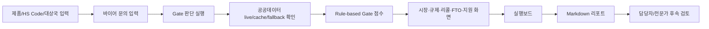

## 3. 접속 및 첫 화면

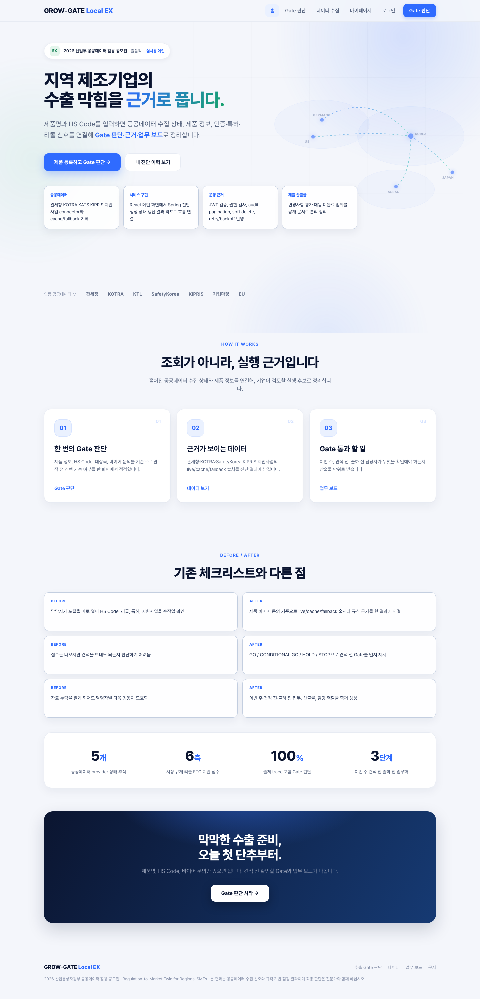

첫 화면은 서비스가 "지역 제조기업의 수출 막힘을 근거로 푸는" 도구임을 설명합니다. 처음 보는 사용자는 여기서 두 가지를 확인하면 됩니다.

- `제품 등록하고 Gate 판단`: 새 진단을 시작하는 기본 버튼입니다.
- `내 진단 이력 보기`: 이미 실행한 Gate 판단 결과를 다시 보는 버튼입니다.

상단 메뉴는 홈, Gate 판단, 데이터 수집, 마이페이지로 구성됩니다. 심사위원에게는 첫 화면의 `근거가 보이는 데이터`, `Gate 통과 할 일`, `공공데이터 provider 상태 추적` 설명이 서비스의 핵심 방향을 보여주는 포인트입니다.

로그인 화면은 다음과 같습니다.

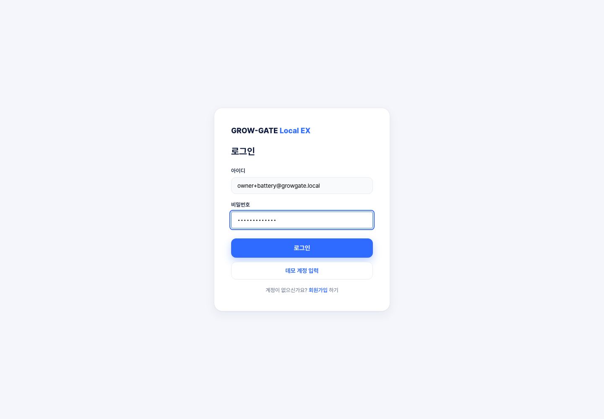

시연에서는 `owner+battery@growgate.local / growgateadmin` 계정을 사용했습니다. 화면에는 `데모 계정 입력` 버튼도 있지만, 해당 버튼은 기본 admin 계정을 채우는 용도입니다.

## 4. 제품/기업 정보 입력

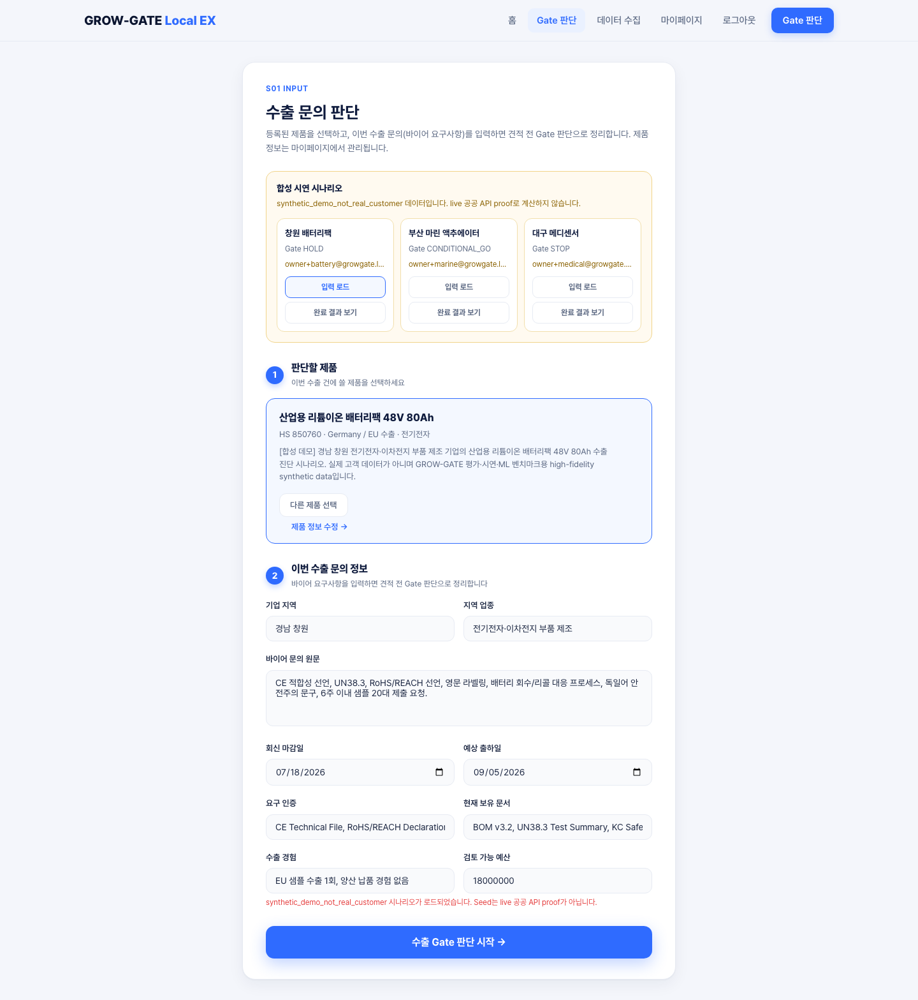

필수 시나리오의 업무 맥락은 다음과 같습니다.

| 항목 | 입력 또는 설명 |
| :--- | :--- |
| 회사명 | 경남 배터리테크 |
| 제품명 | 리튬이온 배터리팩 |
| HS Code | 850760 |
| 대상국 | Germany / EU |
| 바이어 문의 | 독일 전동공구 제조사에서 리튬이온 배터리팩 공급 가능 여부를 문의했습니다. CE, 배터리 규제, 리콜 이력, 특허 리스크, 납기 가능성, 정부 지원사업 여부를 확인하고 싶습니다. |
| 제품 특성 | 리튬이온 셀, BMS, 보호회로, 플라스틱 케이스 |
| 용도 | 전동공구용 배터리팩 |
| 수출 목적 | 독일 바이어 대응 및 초도 수출 가능성 판단 |

현재 실제 입력 화면에서 회사명은 별도 텍스트 입력 필드가 아니라 로그인 계정/마이페이지 제품 맥락으로 관리됩니다. 진단 입력 화면에는 다음 값이 직접 들어갑니다.

- 판단할 제품: 마이페이지에 저장된 제품을 선택하거나 `+ 새 제품 등록`으로 등록합니다.
- 기업 지역: 경남 창원처럼 지역산업 맥락을 넣습니다.
- 지역 업종: 전기전자, 배터리 등 지원사업/산업 맥락에 쓰입니다.
- 바이어 문의 원문: 요구 인증, 납기, 샘플 요청, 우려 사항을 그대로 입력합니다.
- 회신 마감일/예상 출하일: 실행보드의 기한 산정에 사용됩니다.
- 요구 인증/현재 보유 문서: 규제·인증 gap과 출하 전 문서 패키지 점검에 사용됩니다.
- 수출 경험/검토 가능 예산: 실행 우선순위와 지원사업 검토 맥락에 사용됩니다.

초보자는 HS Code를 모르면 제품명과 설명으로 먼저 내부 담당자에게 확인하고, 임시로 알고 있는 6자리 품목군을 넣어 1차 진단한 뒤 나중에 수정하는 방식이 적절합니다.

## 5. 진단 실행

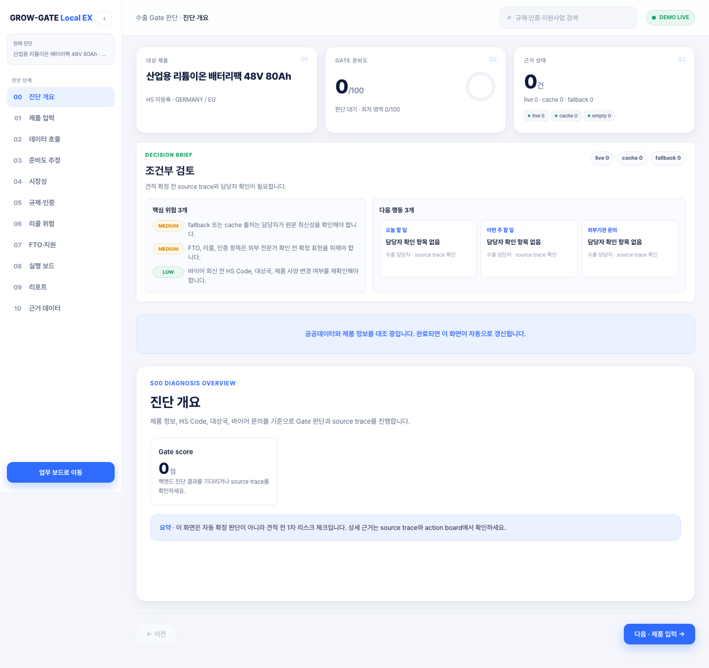

`수출 Gate 판단 시작` 버튼을 누르면 Spring backend가 진단 run을 생성하고 `/diagnosis/{id}` 결과 화면으로 이동합니다. 캡처 당시 운영 서버에서는 처리가 빠르게 완료되어 loading 화면 대신 결과 개요가 바로 표시되었습니다.

내부적으로 진행되는 일은 다음과 같습니다.

- 제품명, HS Code, 대상국, 바이어 문의를 정규화합니다.
- 공공데이터 provider와 cache/fallback 상태를 확인합니다.
- 보유 문서, 인증, FTO, 리콜, 지원사업 신호를 rule score에 반영합니다.
- fallback이나 source 부족은 positive contribution으로 쓰지 않고 검토 필요 상태로 표시합니다.
- LLM/Agent 보조 문장은 리포트와 설명을 사람이 읽기 좋게 정리하는 데 한정합니다.

과장해서 "AI가 자동으로 수출 가능 여부를 확정한다"고 설명하면 안 됩니다. 이 화면은 견적 전 사전 진단입니다.

## 6. 시장성 결과 확인

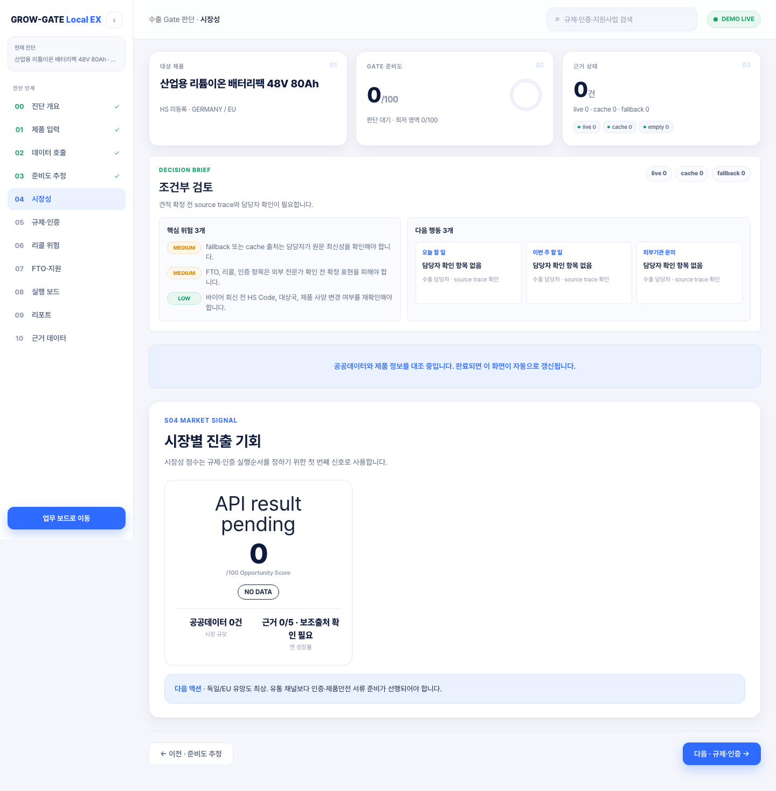

S04 시장성 화면은 대상국/시장 점수와 공공데이터 근거 상태를 함께 보여줍니다. 점수는 0~100 사이이며, 높을수록 해당 제품과 대상국 조합의 시장 신호가 긍정적이라는 의미입니다.

해석 기준은 다음과 같습니다.

- 높음: 바이어 대응을 진행하되 규제·인증/FTO 확인을 병행합니다.
- 보통: 시장성은 가능성이 있으나 문서, 인증, 납기, 비용 확인이 필요합니다.
- 낮음: 시장 접근보다 규제, 리콜, 지원사업 또는 대체시장 검토가 먼저일 수 있습니다.

화면에 `공공데이터 N건`, `보조출처 N건`, `근거 N/5` 같은 문구가 나오면, 해당 점수가 단순 추정이 아니라 source trace와 연결되어 있다는 뜻입니다. 단, `fallback`, `empty`, `seed`는 live 공공 API proof가 아닙니다.

## 7. 규제·인증 확인

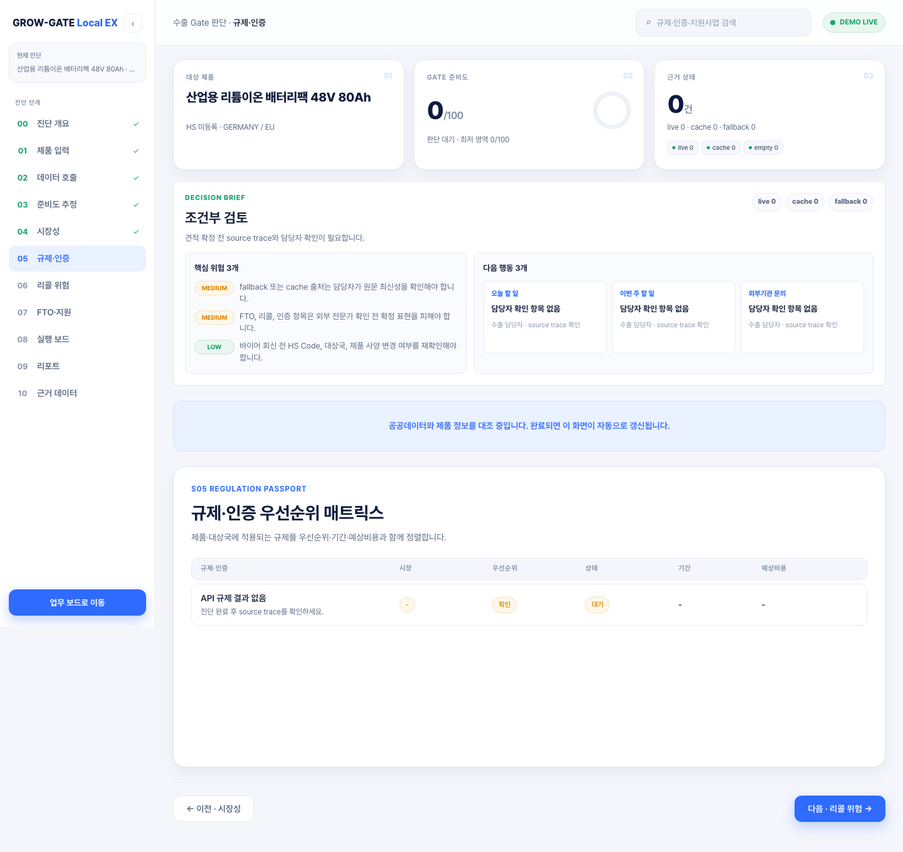

S05 규제·인증 화면은 CE, 배터리 규제, 제품안전, 보유 문서 상태를 사전 점검하는 화면입니다. 사용자는 다음을 확인해야 합니다.

- 대상국 규제 준비도: 현재 제품 지식과 입력값 기준으로 규제 대응이 얼마나 준비되었는지 봅니다.
- 우선순위: 견적 전 반드시 확인해야 하는지, 출하 전 확인해도 되는지 판단합니다.
- 상태: 누락위험, 보완필요, 대응가능 등을 확인합니다.
- 기간/비용: 인증기관 견적 또는 시험기간을 별도 확인해야 하는지를 봅니다.

중요한 한계: 이 화면은 인증 확정 판정이 아닙니다. CE 적합성, EU 배터리 규정 준수, 통관 가능 여부는 인증기관, 시험기관, 관세/법률 전문가가 최종 확인해야 합니다.

## 8. 리콜·제품안전 확인

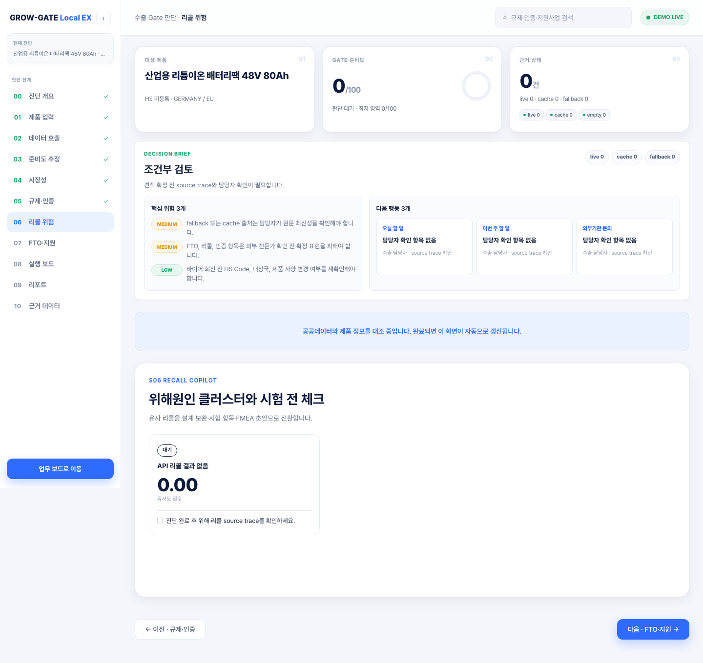

S06 리콜 화면은 제품군 위해·리콜 신호와 시험 전 체크 항목을 보여줍니다. 배터리팩의 경우 UN38.3, IEC62133, 제품안전 문서, 회수/리콜 대응 프로세스가 주요 확인 대상입니다.

사용자는 다음을 확인합니다.

- 유사도 점수: 제품군 위험 신호의 상대적 강도입니다.
- 체크리스트: 출하 전 품질/인증 담당자가 확인할 항목입니다.
- source trace: 제품안전/리콜 공공데이터가 live/cache/fallback 중 무엇인지 S10에서 확인합니다.

리콜 데이터가 없다고 해서 안전하다는 뜻은 아닙니다. 데이터가 없거나 fallback이면 "조회 근거 부족"일 수 있으므로 담당자 확인과 문서 보강이 필요합니다.

## 9. FTO/특허 리스크 확인

S07의 왼쪽 영역은 FTO/특허 위험지도입니다. 제품명, 기술 키워드, 구성부품, 경쟁사 키워드를 바탕으로 사전 위험 신호를 보여줍니다.

이 화면은 법률 의견이 아닙니다. 다음 후속 조치가 필요할 수 있습니다.

- KIPRIS 키워드와 경쟁사명을 기준으로 1차 검색
- BMS, 방열, 보호회로, 구조 설계 키워드 보강
- 변리사 검토 메모 작성
- 필요 시 회피 설계 또는 청구항 분석 요청

발표 시에는 "특허 침해 없음"이라고 말하지 말고, "견적 확정 전 전문가 검토가 필요한 후보를 좁혀준다"고 설명해야 합니다.

## 10. 지원사업 확인

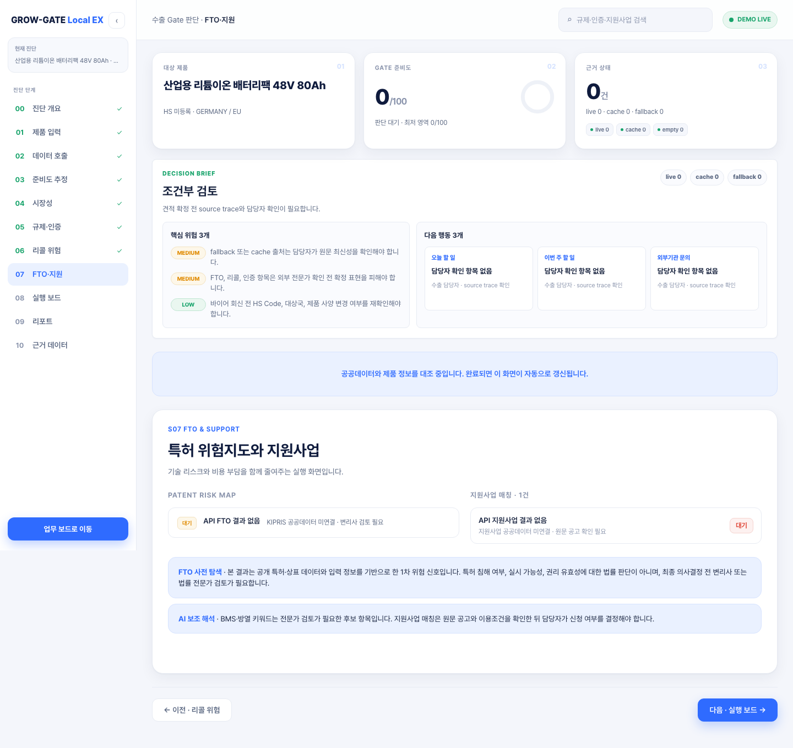

S07의 오른쪽 영역은 지원사업 매칭입니다. 지역, 업종, 수출단계, 인증 필요 여부를 바탕으로 KOTRA, 기업마당, 지자체·테크노파크 등의 지원사업 후보를 보여주는 영역입니다.

사용자는 다음 순서로 확인합니다.

1. 제품과 대상국에 맞는 지원사업 후보가 있는지 봅니다.
2. `보강`, `우선` 같은 상태를 보고 신청 전 확인 필요 수준을 파악합니다.
3. 원문 공고 URL, 신청 조건, 접수 마감일, 제출 서류는 별도로 확인합니다.
4. 화면의 추천은 신청 가능 확정이 아니라 우선 검토 후보로 사용합니다.

## 11. 실행보드 확인

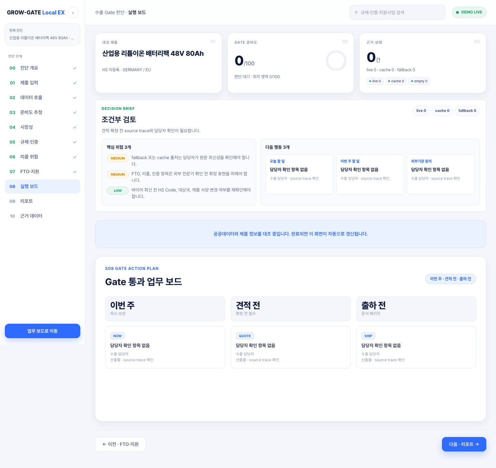

S08 실행보드는 진단 결과를 실제 업무로 바꾸는 화면입니다. 현재 화면은 `이번 주`, `견적 전`, `출하 전`으로 나뉘며 각 카드에는 업무, 담당자, 산출물, 기한이 표시됩니다.

배터리팩 시나리오에서 대표적인 업무는 다음과 같습니다.

- 인증자료 준비: UN38.3/IEC62133 보유 여부와 시험기관 견적 확인
- 리콜 유사사례 검토: 제품안전/리콜 trace와 내부 품질 문서 비교
- 바이어 회신자료 작성: 보유 문서, 누락 문서, 확인 일정 정리
- FTO 사전 검토: KIPRIS 키워드와 경쟁사명 기반 1차 검색
- 지원사업 신청 검토: 인증·전시회·수출바우처 등 후보 원문 확인

실행보드는 final judgment가 아니라 업무 분배 도구입니다. 업무 완료 후 재진단하거나 보유 문서를 지식화하면 다음 판단의 근거가 좋아집니다.

## 12. 공공데이터 근거 확인

S10 근거 데이터 화면은 심사위원에게 가장 중요한 증거 화면입니다. 여기서는 provider별로 source type, raw hash, schema validation, record 수, fallback reason을 확인합니다.

확인해야 할 핵심 기준은 다음과 같습니다.

- `live`: 현재 API 호출로 얻은 근거입니다.
- `cache`: 이전 live 수집 또는 CSV/cache 근거입니다.
- `fallback`: API key 미설정, endpoint 문제, timeout, parser 실패 등으로 대체 처리된 상태입니다.
- `empty`: 조회 결과가 없거나 설정이 부족한 상태입니다.
- `seed`: 합성 시연 데이터입니다. 실제 공공 API proof가 아닙니다.

상세 출처 화면에서는 공공데이터 근거와 보조근거, 규칙 엔진 근거를 분리해서 볼 수 있습니다.

공개 데이터 수집 대시보드는 proof run, schema pass/fail, provider 상태를 보여줍니다.

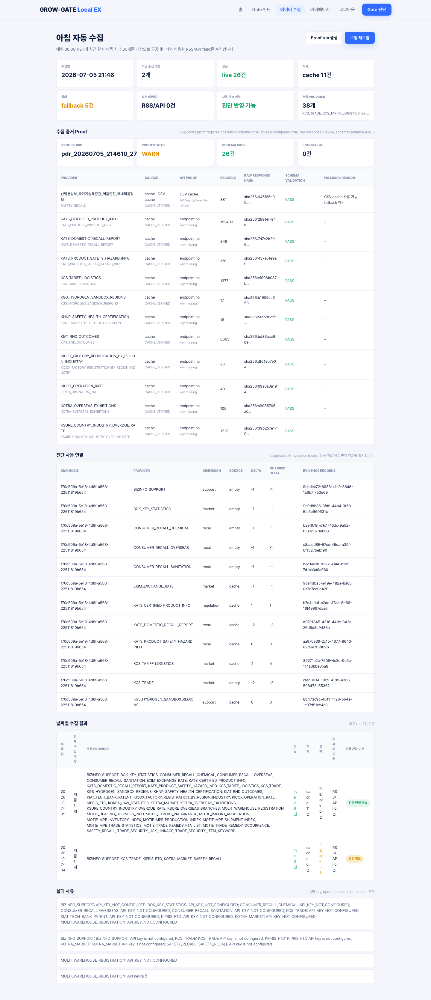

심사위원에게는 `proofRunId`, `rawResponseSha256`, `schemaValidation`, `operationEndpoint`, `apiKeyConfigured`, `live/cache/fallback 구분`을 보여주면 됩니다. fallback이나 seed를 live처럼 설명하면 안 됩니다.

## 13. 리포트 생성 및 다운로드

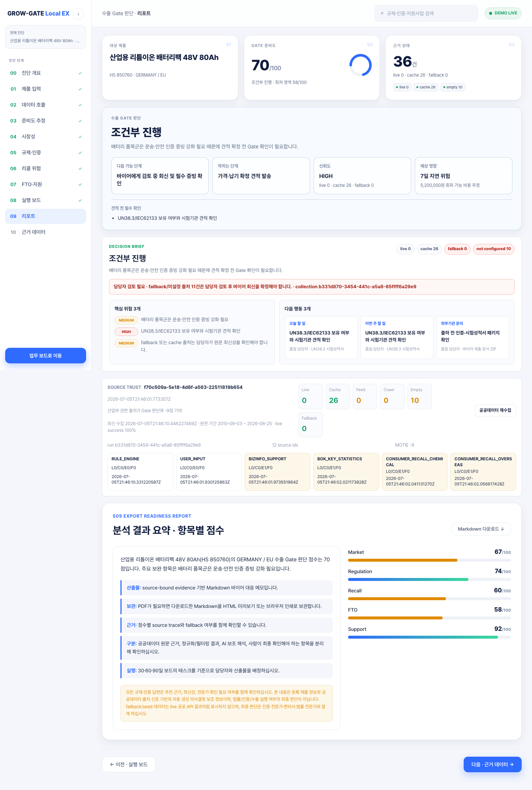

S09 리포트 화면은 최종 분석 요약과 항목별 점수를 보여줍니다. 화면 오른쪽 위의 `Markdown 다운로드` 버튼으로 공식 산출물인 Markdown 리포트를 받을 수 있습니다.

이번 캡처에서 실제 다운로드된 파일은 [sample-report.md](screenshots/e2e-user-manual/sample-report.md)입니다. 리포트에는 다음이 포함되었습니다.

- diagnosisId
- publicDataProofRunId
- Gate 판단 점수
- 바이어에게 보낼 1차 회신 초안
- 담당자 즉시 할 일
- Public Data Proof
- Claim Verification
- Source Appendix
- synthetic validation disclaimer

리포트 활용 예시는 다음과 같습니다.

- 내부 회의: 영업, 품질, 개발, 대표가 같은 Gate 판단과 실행보드를 공유합니다.
- 바이어 응답 초안: "현재 확인 중인 인증/FTO/리콜 근거와 회신 일정"을 정리합니다.
- 인증/특허 검토 요청서: 시험기관/변리사에게 검토 범위를 전달합니다.
- 지원사업 신청 준비자료: 제품, 대상국, 인증 필요성, 일정, 산출물을 정리합니다.

현재 구현의 공식 산출물은 Markdown입니다. PDF는 앱 내 서버 PDF 생성 기능이 아니라 브라우저 인쇄 또는 CI 변환 전략으로 보관합니다.

모바일 화면도 최소 확인했습니다.

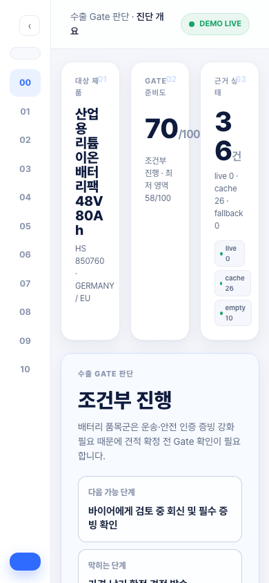

모바일에서도 결과 화면은 열리지만, 제출/발표용 기본 캡처는 데스크톱 기준이 더 안정적입니다.

## 14. 신규 사용자를 위한 5분 데모 흐름

| 시간 | 화면 | 발표 멘트 | 심사위원 포인트 |
| :--- | :--- | :--- | :--- |
| 0:00-0:30 | 홈 | "지역 제조기업이 바이어 문의를 받았을 때 견적 전 확인할 Gate를 한 번에 봅니다." | 서비스 대상과 문제 정의 |
| 0:30-1:00 | 로그인/입력 | "제품, HS Code, 대상국, 바이어 요구 인증과 보유 문서를 입력합니다." | 실제 사용자 입력 흐름 |
| 1:00-1:40 | 진단 개요 | "최종 Gate는 rule score와 risk/fallback 조건으로 결정됩니다. LLM은 결정을 바꾸지 않습니다." | 과장 없는 AI 설명 |
| 1:40-2:20 | 시장/규제 | "시장성은 공공데이터와 보조근거 상태를 함께 보고, 규제·인증은 사전 체크로만 사용합니다." | 공공데이터와 사전검토 구분 |
| 2:20-3:00 | 리콜/FTO | "리콜 없음은 안전 확정이 아니고, FTO는 법률 의견이 아니라 변리사 검토 후보입니다." | 위험 문구 차단 |
| 3:00-3:40 | 실행보드 | "결과를 이번 주, 견적 전, 출하 전 업무와 산출물로 바꿉니다." | 실제 업무 적용성 |
| 3:40-4:30 | S10 proof | "provider별 live/cache/fallback, proofRunId, schema validation으로 근거를 확인합니다." | 공공데이터 활용 증거 |
| 4:30-5:00 | 리포트 | "Markdown 리포트는 내부 회의와 바이어 회신 초안으로 사용합니다." | 산출물과 후속 활용 |

자세한 발표 멘트는 [e2e-demo-script.md](e2e-demo-script.md)에 분리했습니다.

## 15. 자주 묻는 질문

### HS Code를 모르면 어떻게 하나?

정확한 HS Code는 통관·관세 판단의 핵심이므로 담당자나 관세 전문가 확인이 필요합니다. 다만 1차 진단은 알고 있는 6자리 품목군으로 시작하고, 나중에 제품 정보를 수정해 재진단할 수 있습니다.

### 바이어 문의가 짧아도 진단 가능한가?

가능합니다. 하지만 요구 인증, 납기, 샘플 수량, 대상국, 보유 문서가 자세할수록 실행보드와 리포트가 더 구체적입니다.

### 점수가 높으면 바로 수출 가능한가?

아닙니다. 점수는 견적 전 준비도와 위험 신호를 보여주는 사전 진단입니다. 인증, 통관, 법률, 특허, 계약 조건은 전문가와 최종 확인해야 합니다.

### 리콜 데이터가 없으면 안전하다는 뜻인가?

아닙니다. 리콜 데이터 없음은 "조회된 근거가 없음" 또는 "수집 설정/범위 부족"일 수 있습니다. 안전성 확정으로 해석하면 안 됩니다.

### FTO 결과는 법률 의견인가?

아닙니다. FTO 화면은 공개 특허·상표 데이터와 입력 키워드 기반 사전 위험 신호입니다. 특허 침해 여부, 권리 유효성, 실시 가능성은 변리사 또는 법률 전문가 검토가 필요합니다.

### fallback 데이터가 나오면 어떻게 해석해야 하나?

fallback은 API key 미설정, endpoint 문제, timeout, parser 실패 등으로 공식 live 근거가 부족하다는 신호입니다. 점수를 올리는 근거로 쓰지 않고, 담당자 재수집 또는 보유 문서 확인 대상으로 봐야 합니다.

### 리포트는 어디에 활용할 수 있나?

내부 회의, 바이어 회신 초안, 인증기관/변리사 검토 요청, 지원사업 신청 준비자료로 활용할 수 있습니다. 단, 리포트 자체가 법률·인증·통관 최종 판단은 아닙니다.

## 16. 한계와 주의사항

현재 구현 기준의 한계는 다음과 같습니다.

- 최종 Gate는 deterministic rule score와 risk/fallback 조건으로 결정됩니다. AI가 최종 수출 결정을 자동 확정하지 않습니다.
- 공공데이터 provider는 live/cache/fallback/empty/seed로 구분됩니다. fallback, seed, empty는 live 공공 API proof가 아닙니다.
- 시연 계정과 일부 제품 데이터는 `synthetic_demo_not_real_customer`입니다. 실제 고객 데이터나 고객 인터뷰 자료로 설명하면 안 됩니다.
- 인증, 법률, 특허, 통관, 원산지, 관세율 확정은 전문가 검토가 필요합니다.
- 지원사업 추천은 후보 목록이며 신청 가능성, 선정 가능성, 지원금 수령을 보장하지 않습니다.
- 현재 리포트 공식 산출물은 Markdown입니다. PDF는 브라우저 인쇄나 별도 CI 변환을 통해 보관합니다.
- 모바일 화면은 접근 가능하지만, 심사/발표 캡처와 실제 업무 사용은 데스크톱 화면을 기준으로 하는 것이 안정적입니다.

## 캡처 및 검증 기록

| 파일 | 확인 내용 |
| :--- | :--- |
| `01-home.png` | 홈/서비스 목적 |
| `02-login.png` | 로그인 |
| `03-product-input.png` | 제품 선택 및 바이어 문의 입력 |
| `04-diagnosis-running.png` | 진단 실행 후 결과 개요 |
| `05-market-result.png` | 시장성 결과 |
| `06-regulation-certification.png` | 규제·인증 |
| `07-recall-safety.png` | 리콜·제품안전 |
| `08-fto-risk.png` | FTO/특허 위험 |
| `09-support-programs.png` | 지원사업 |
| `10-action-board.png` | 실행보드 |
| `11-public-data-proof.png` | S10 proof |
| `12-report.png` | 리포트 |
| `13-mobile-check.png` | 모바일 확인 |
| `14-source-detail.png` | 진단 근거 및 출처 |
| `15-public-data-dashboard.png` | 공공데이터 수집 대시보드 |
| `sample-report.md` | 실제 다운로드된 Markdown 리포트 |
