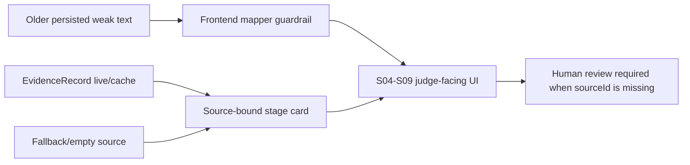

# Source-Bound Stage Card Display Hardening - 2026-07-06

## Context

Judge-facing diagnosis stages S04-S09 showed technically true but weak strings such as `0 live/cache`, `evidence 0/5`, `Safety source trace 0건`, and `Spring 로컬 생성기`. Those strings made the product look unfinished and made source gaps hard to interpret.

## Root Cause

Backend stage cards mixed implementation labels with presentation text, and the frontend mapper passed those strings through directly. Older persisted diagnosis records could therefore keep showing weak labels even after public-data proof and source-quality fields existed elsewhere in the response.

## Fix

The backend now emits stage cards with source-bound, judge-readable labels:

| Stage | Display Contract |
| :--- | :--- |
| S04 Market | `공공데이터 N건`, `근거 N/5`, explicit review-required note when live/cache is absent |
| S05 Regulation | rule score is described as deterministic registered product/certification knowledge, not as an AI claim |
| S06 Recall | product safety/recall public-data count, external support count, fallback count, and human review action |
| S07 FTO/Support | KIPRIS and support-program public-data status, with attorney or source-owner review when missing |
| S08 Action Board | duplicate action items are collapsed per lane |
| S09 Report | source-bound Markdown report wording, no framework/runtime leakage |

The frontend mapper also sanitizes old persisted stage card strings so prior diagnosis results render under the same contract.

## Agent Roles

The display contract maps to bounded agent responsibilities:

| Agent | Output Boundary |
| :--- | :--- |
| MarketSignalAgent | Market score text may cite only source IDs or clearly label missing public evidence |
| RegulationCertificationAgent | Certification/regulation rows are advisory and set `humanReviewRequired` when evidence is incomplete |
| RecallRiskAgent | Recall checks show source count and fallback state; no "recall clearance" claim |
| FtoPatentAgent | FTO signals are not legal conclusions and require attorney review when KIPRIS live/cache is absent |
| SupportMatchAgent | Support matches are program candidates, not approval or funding certainty |
| ReportAgent | Report summaries describe source-bound evidence, not model autonomy |
| CriticVerifierAgent | Source-less claims are removed or downgraded to review-required text |

## Regression Tests

`frontend/FE-02/src/services/diagnosisService.mapper.test.js` now covers:

- legacy weak strings are normalized before rendering;
- S04 no-public-data state says `공공데이터 0건`;
- S05 does not expose `Spring rule score`;
- S06 no-source state is an explicit human-review checklist;
- S07 KIPRIS/support zero-source state is not presented as public proof;
- S08 duplicate actions are deduplicated;
- S09 never shows `Spring 로컬 생성기`.

## Can Say / Cannot Say

Can say:

- "S04-S09 distinguish live/cache, external support, fallback, and missing sources."
- "Fallback or missing public-data evidence creates review-required actions."
- "The final Gate remains deterministic and LLM text is advisory."

Cannot say:

- "0건 means the product is safe or cleared."
- "Fallback/empty data is live public API evidence."
- "The AI autonomously makes the export decision."
