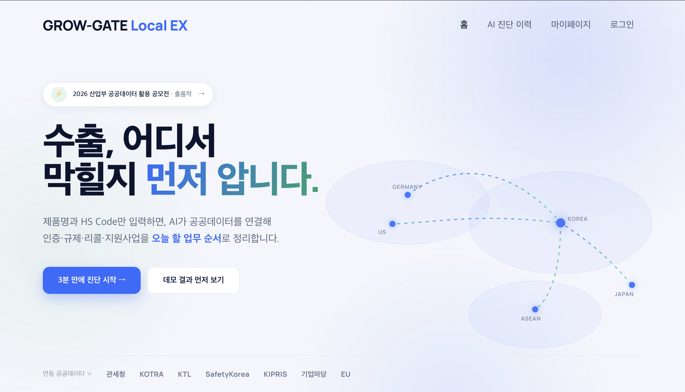
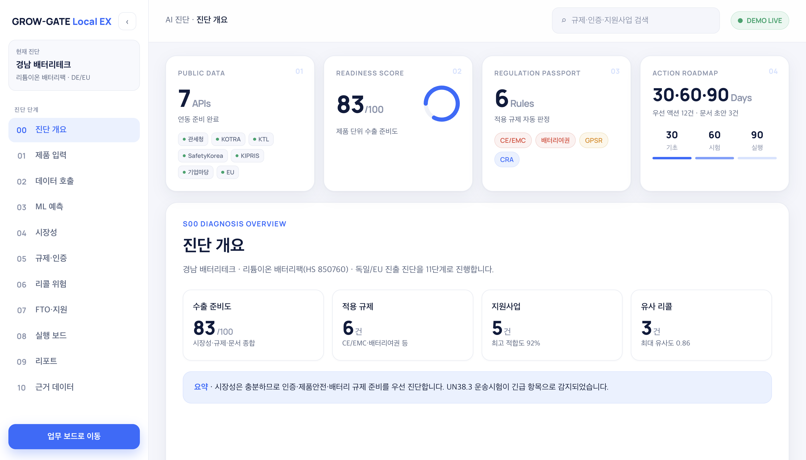

# GROW-GATE Local EX — Frontend

---

## Table of Contents

1. [Key Screens](#1-key-screens)
2. [Tech Stack](#2-tech-stack)
3. [Getting Started](#3-getting-started)
4. [Project Structure](#4-project-structure)
5. [Routing](#5-routing)
6. [Permission Structure](#6-permission-structure)
7. [Development Guidelines](#7-development-guidelines)
8. [Backend Integration Guide](#8-backend-integration-guide)
9. [Required Backend APIs](#9-required-backend-apis)
10. [TODO](#10-todo)

---

## 1. Key Screens

| 홈 | AI 진단 결과 |
| :--- | :--- |
|  |  |

---

## 2. Tech Stack

| 항목 | 내용 |
| :--- | :--- |
| 프레임워크 | React 18 + Vite 5 |
| 라우팅 | React Router v6 |
| 스타일 | CSS Modules |
| 언어 | JavaScript (JSX, TypeScript 미사용) |

---

## 3. Getting Started

### 요구 사항

- Node.js `v18` 이상 (LTS 권장)
- npm `v9` 이상

### 설치 및 실행

```bash
npm install        # 의존성 설치
npm run dev        # 개발 서버 (http://localhost:5173)
npm run build      # 프로덕션 빌드
npm run preview    # 빌드 결과 로컬 미리보기
```

### 환경 변수

```bash
cp .env.example .env
```

| 변수 | 설명 | 기본값 |
| :--- | :--- | :--- |
| `VITE_API_URL` | 백엔드 API 기본 URL. 비워두면 현재 origin의 `/api` 사용 | 비움 |
| `VITE_API_TIMEOUT_MS` | API 요청 timeout | `15000` |
| `VITE_API_RETRY_COUNT` | GET 요청 retry 횟수 | `2` |
| `VITE_ENABLE_MOCK` | API 실패 시 mock fallback 허용 여부 | `false` |

> Vite에서 브라우저에 노출되는 환경 변수는 `VITE_` 접두사 필수.  
> 코드에서 `import.meta.env.VITE_API_URL`로 접근. 로컬 Spring을 직접 호출할 때만 `.env`에 `VITE_API_URL=http://localhost:8080`을 지정합니다.

---

## 4. Project Structure

```
src/
├── main.jsx                    # ReactDOM 마운트
├── App.jsx                     # 라우트 전체 정의
├── styles/global.css           # CSS 변수 + 전역 스타일
│
├── mock/                       # 개발용 fallback 데이터 (VITE_ENABLE_MOCK=true에서만 조회 실패 대체)
│   ├── auth.js                 # 로그인 상태 (isLoggedIn, role, accountType)
│   ├── roles.js                # 역할별 허용 액션 테이블
│   ├── diagnosisSteps.js       # 진단 단계 정의 (UI 전용)
│   ├── diagnosisData.js        # S00~S10 진단 결과 데이터
│   ├── diagnosisListData.js    # 진단 이력 목록 데이터
│   └── productData.js          # 제품 지식 데이터
│
├── services/                   # API 추상화 계층
│   ├── diagnosisService.js     # 진단 관련 (목록 조회, 결과 조회, 실행)
│   └── productService.js       # 제품 지식 관련 (조회, 저장, 생성)
│
├── hooks/
│   └── usePermission.js        # 역할 기반 권한 확인 훅
│
├── components/
│   ├── route/ProtectedRoute.jsx        # 로그인·권한 보호 라우트
│   ├── layout/                         # AppLayout, Sidebar, Topbar, KpiRow
│   ├── ui/                             # Pill, MemoBox, Pager, DonutChart, StatusMessage
│   └── diagnosis/                      # DiagnosisStage + S00~S10 스테이지 컴포넌트
│
└── pages/
    ├── auth/                   # Home, Login, Signup, SignupPersonal, SignupCompany
    ├── diagnosis/              # DiagnosisList, DiagnosisNew, DiagnosisResult, DiagnosisSources
    └── mypage/                 # Mypage, Knowledge, KnowledgeNew, KnowledgeDetail, KnowledgeEdit
```

---

## 5. Routing

| 경로 | 페이지 | 접근 조건 |
| :--- | :--- | :--- |
| `/` | Home | 공개 |
| `/login` | Login | 공개 |
| `/signup` | Signup | 공개 |
| `/signup/personal` | SignupPersonal | 공개 |
| `/signup/company` | SignupCompany | 공개 |
| `/diagnosis` | DiagnosisList | 로그인 |
| `/diagnosis/new` | DiagnosisNew | 로그인 |
| `/diagnosis/:id` | DiagnosisResult | 로그인 |
| `/diagnosis/:id/sources` | DiagnosisSources | 로그인 |
| `/mypage` | Mypage | 로그인 |
| `/mypage/knowledge` | Knowledge | 로그인 |
| `/mypage/knowledge/new` | KnowledgeNew | 기업 계정 |
| `/mypage/knowledge/:productId` | KnowledgeDetail | 로그인 |
| `/mypage/knowledge/:productId/edit` | KnowledgeEdit | 기업 계정 |

---

## 6. Permission Structure

역할 계층: `owner` > `admin` > `editor` > `viewer`

| 액션 | owner | admin | editor | viewer |
| :--- | :--- | :--- | :--- | :--- |
| `knowledge:create` | ✓ | ✓ | | |
| `knowledge:edit` | ✓ | ✓ | ✓ | |
| `knowledge:view` | ✓ | ✓ | ✓ | ✓ |
| `audit:view` | ✓ | ✓ | | |

컴포넌트에서 `usePermission` 훅으로 접근.

```js
const { can } = usePermission()
if (can('knowledge:edit')) { ... }
```

---

## 7. Development Guidelines

### 스타일

- 전역 공유 스타일 → `styles/global.css` (CSS 변수, reset, 공통 클래스)
- 컴포넌트 고유 스타일 → `ComponentName.module.css` (CSS Modules, 로컬 스코프)
- 전역 클래스 (`pill`, `big`, `eyebrow` 등)는 `global.css`에서만 정의

### 파일 명명

| 대상 | 규칙 | 예시 |
| :--- | :--- | :--- |
| 컴포넌트 | PascalCase | `DiagnosisResult.jsx` |
| CSS 모듈 | 컴포넌트명 동일 | `DiagnosisResult.module.css` |
| 서비스·훅·목업 | camelCase | `diagnosisService.js` |
| 상수 | UPPER_SNAKE_CASE | `DIAGNOSIS_STEPS` |

### 컴포넌트 패턴

- 페이지 컴포넌트는 `pages/` 하위, 재사용 컴포넌트는 `components/` 하위로 분리
- 데이터 조회는 반드시 `services/`를 통해 수행 (컴포넌트에서 `mock/` 직접 import 금지)

---

## 8. Backend Integration Guide

현재 `services/`는 Spring Boot `/api`를 기본 호출합니다. 제출/운영 기본값에서는 API 실패를 mock 성공으로 숨기지 않고 error state로 전파합니다. 개발 중 화면 확인이 필요할 때만 `.env`에 `VITE_ENABLE_MOCK=true`를 설정하면 조회 API에 한해 fallback이 동작합니다.

```js
// 기본: 실 API 호출, 실패 시 에러 전파
export async function getProducts() {
  try {
    const res = await apiFetch('/products')
    return res.products.map(mapProductSummary)
  } catch (err) {
    if (!ENABLE_MOCK) throw err
    return PRODUCTS
  }
}
```

> 공통 fetch 헬퍼는 `services/apiClient.js` 참고. `VITE_API_URL`이 비어 있으면 현재 origin의 `/api`를 사용하고, 값이 있으면 `${VITE_API_URL}/api`를 베이스로 씁니다.

**개발용 mock 정리 대상**

| 파일 | 처리 |
| :--- | :--- |
| `mock/productData.js` | `VITE_ENABLE_MOCK=true` 개발 fallback 외 사용 금지 |
| `mock/diagnosisData.js` | 결과 단계 UI 기본 shape 유지용, 실제 점수/세션은 API 응답으로 덮어씀 |
| `mock/diagnosisListData.js` | `VITE_ENABLE_MOCK=true` 개발 fallback 외 사용 금지 |
| `mock/auth.js` | 사용하지 않음 |
| `mock/roles.js` | UI 보조 권한 테이블, 서버 권한 검증을 대체하지 않음 |
| `mock/diagnosisSteps.js` | UI 전용이므로 유지 가능 |

---

## 9. Required Backend APIs

아래 경로는 백엔드(`backend/BE-02`) 실제 구현 기준입니다. `services/apiClient.js`는 기본적으로 현재 origin의 `/api`를 사용하며, `VITE_API_URL`이 설정되어 있으면 `${VITE_API_URL}/api`를 베이스로 사용합니다. `VITE_API_URL`이 이미 `/api`로 끝나는 경우 중복으로 붙이지 않습니다.

### 인증·사용자

| 메서드 | 경로 | 설명 | 서비스 파일 |
| :--- | :--- | :--- | :--- |
| `POST` | `/api/auth/login` | 이메일·비밀번호 로그인, JWT 발급 | `authService.js` |
| `POST` | `/api/auth/signup` | 회원가입 (개인/기업 구분은 요청 바디로 전달) | `authService.js` |
| `POST` | `/api/auth/logout` | 클라이언트 토큰 제거 | `authService.js` |
| `GET` | `/api/users/me` | 현재 로그인 사용자 정보 조회 | `mypageService.js` |
| `PATCH` | `/api/users/me` | 사용자 정보 수정 | `authService.js` |
| `GET` | `/api/companies/me` | 소속 기업 정보 조회 (기업 계정) | `mypageService.js` |
| `PATCH` | `/api/companies/me` | 소속 기업 정보 수정 (기업 계정) | 구현 엔드포인트 |

### 제품 지식

> 연동 완료 (`apiFetch` 베이스: 기본 `/api`, `VITE_API_URL` 설정 시 `${VITE_API_URL}/api`). 제출 기본값에서는 실패 시 error state로 전파합니다.

| 메서드 | 경로 | 설명 | 서비스 함수 |
| :--- | :--- | :--- | :--- |
| `GET` | `/api/products` | 제품 목록 조회 | `getProducts()` |
| `POST` | `/api/products` | 신규 제품 생성 | `createProduct(payload)` |
| `GET` | `/api/products/:productId/knowledge` | 제품 상세·지식 조회 (인증서·FTO·바이어요구사항·출처 포함) | `getProductKnowledge(id)` |
| `PUT` | `/api/products/:productId/knowledge` | 제품 정보·지식 수정 | `saveProductKnowledge(id, payload)` |
| `DELETE` | `/api/products/:productId` | 제품 소프트 삭제 | `deleteProduct(id)` |
| `GET` | `/api/products/:productId/audit-logs` | 변경 이력 조회 | `getProductAuditLogs(id)` |

인증서/FTO/바이어요구사항/지식출처 등록·수정·삭제 엔드포인트(`/api/products/{productId}/certifications` 등)는 백엔드와 서비스 함수가 구현되어 있습니다. 화면별 버튼 노출 범위는 `KnowledgeEdit`/`KnowledgeDetail` UX에 맞춰 단계적으로 연결합니다. 자세한 경로는 `backend/BE-02/README.md` 4번 섹션 참고.

### 진단

> 연동 완료 (`apiFetch` 베이스: 기본 `/api`, `VITE_API_URL` 설정 시 `${VITE_API_URL}/api`). 제출 기본값에서는 실패 시 error state로 전파합니다.
> 상세 화면은 기존 단계형 UI를 유지하되, 세션/점수/리스크/로드맵/출처는 Spring 진단 응답으로 덮어씁니다.

| 메서드 | 경로 | 설명 | 서비스 함수 |
| :--- | :--- | :--- | :--- |
| `GET` | `/api/diagnosis` | 진단 이력 목록 조회 | `getDiagnosisList()` |
| `POST` | `/api/diagnosis` | 새 진단 실행 요청 | `runDiagnosis(payload)` |
| `GET` | `/api/diagnosis/:id` | 진단 결과 상세 조회 | `getDiagnosisResult(id)` |
| `GET` | `/api/diagnosis/:id/sources` | 진단 출처 데이터 조회 | `getDiagnosisSources(id)` |

> 화면 라우트(`/mypage/knowledge`, `/diagnosis` 등)는 [§5 Routing](#5-routing)의 UI 경로로 위 표의 `/api/...` 경로와는 별개. 화면 라우트는 유지, 실제 백엔드 호출만 `/api` 경로로 연결.

---

## 10. TODO

### 인증·사용자

- [x] 실제 로그인 API 연동 및 JWT 토큰 저장
- [x] 회원가입 API 연동
- [x] 로그아웃 기능
- [ ] 로그인 상태 유지 (LocalStorage / AuthContext)
- [x] 마이페이지 사용자 정보 API 연동

### 진단

- [x] 새 진단 제출 시 실제 API 호출 및 반환 id로 이동
- [ ] 진단 진행 상태 폴링 / WebSocket 실시간 업데이트
- [x] "저장된 제품 지식 불러오기" 버튼 동작 연결
- [ ] 진단 저장·삭제 기능

### 제품 지식

- [ ] KnowledgeEdit 저장 시 `saveProductKnowledge()` 실제 호출 (현재: navigate만)
- [ ] KnowledgeNew 생성 시 `createProduct()` 실제 호출 (현재: navigate만)
- [ ] 문서 파일 업로드 기능

### 공통

- [ ] 에러 경계(ErrorBoundary) 컴포넌트
- [ ] 접근 토큰 만료 시 자동 재발급 처리
- [ ] 화면 스크린샷 / 데모 영상 추가

---
